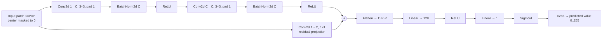
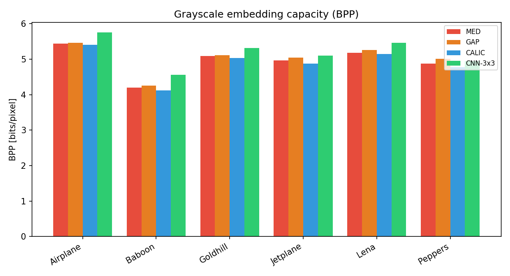
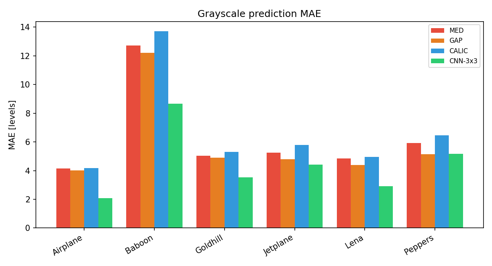
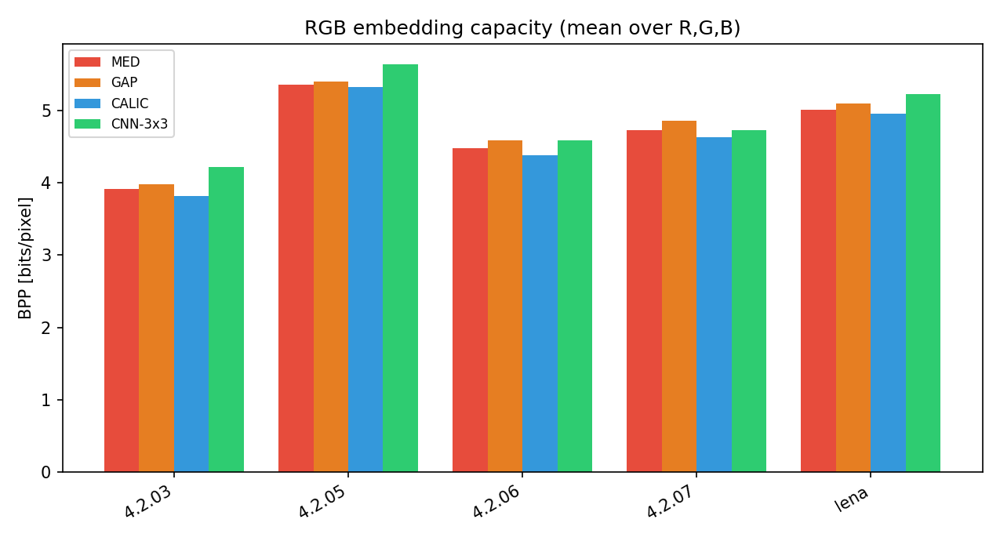
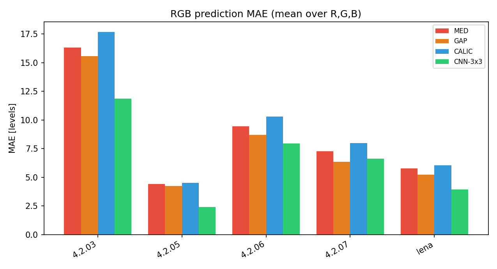
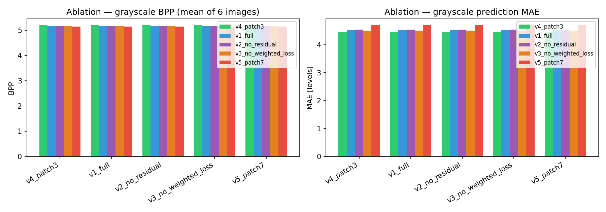
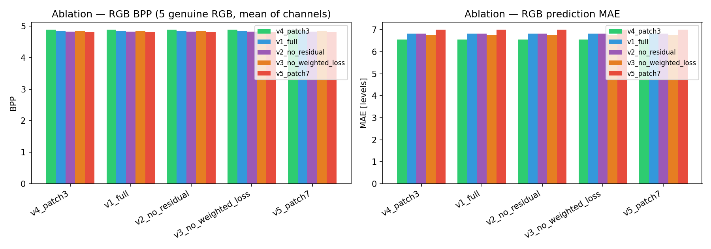
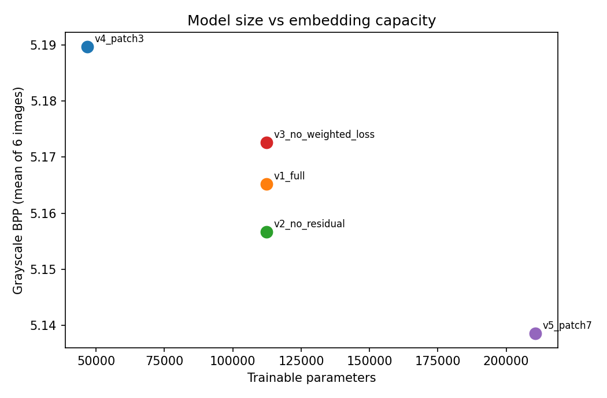
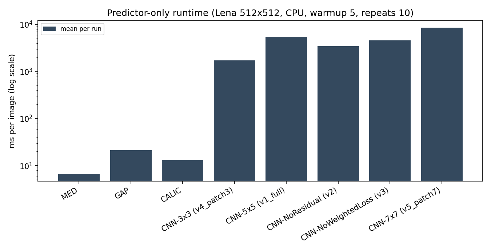
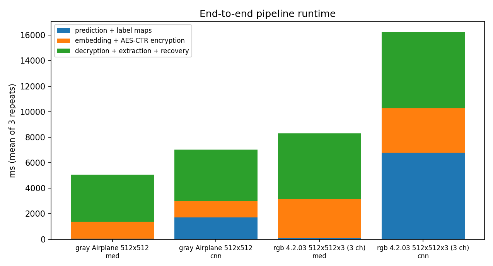

# Final Project Report — CNN-Based Reversible Data Hiding in Encrypted Images using Bit-Plane Replacement

**M.Tech Major Project — Authoritative Technical Record**

**Report status: PARTIALLY VALIDATED** (see §10.7 for the precise scope of validation and the reasons this is not marked `VALIDATED`)

**Technical closure status (2026-10-20): READY WITH DISCLOSED LIMITATIONS** — per `FINAL_CLOSURE_REPORT.md`. This revised manuscript applies only evidence-supported corrections; the disclosed limitations (§7.4, §10.7, §16.6) and the publication blockers (§15 bibliography) remain open and are **not** presented as resolved. Every change in this revision is listed in `MANUSCRIPT_UPDATE_CHANGE_REPORT_20261020.md`. The original file `Final_report.md` is preserved unchanged.

**Validation run date:** 2026-10-18 (all fresh measurements in this report were produced on this date; historical artifacts are dated 2026-10-13 and earlier and are explicitly labelled as such)

**Authoritative implementation:** `RDHEI_FIXED_V1/src/` (project root: `/home/parzifal/RDHEI_Project/RDHEI_FIXED_V1`)

---

## 1. Title page and project overview

**Project title:** CNN-Based Reversible Data Hiding in Encrypted Images using Bit-Plane Replacement

**Research objective:** To build and evaluate a lightweight CNN-based pixel-prediction framework for reversible data hiding in encrypted images (RDHEI), with a comparative evaluation of prediction accuracy, embedding capacity, recovery correctness, model complexity, and computational cost against classical predictors (MED, GAP, CALIC) and against CNN ablation variants.

**Scope and contributions:**

1. A complete RDHEI pipeline (prediction → bit-plane (MSB) replacement embedding → AES-CTR encryption → decryption → payload extraction → exact image recovery), audited line by line against the manuscript-facing claims.
2. A comparative evaluation of four predictors (MED, GAP, CALIC, proposed CNN-3×3) on grayscale and genuine 3-channel RGB benchmark images.
3. A five-checkpoint CNN ablation study (patch size 3/5/7, residual on/off, weighted/plain L1 training loss).
4. Real-image end-to-end acceptance testing across multiple payload lengths (empty to maximum capacity), with pixel-exact image recovery and bit-exact payload recovery verified outside the pipeline's own bookkeeping.
5. Honest computational-cost accounting: predictor-only and end-to-end runtime measurements on a documented protocol.

**Final implementation summary:** The proposed configuration is **CNN-3×3** (`models/v4_patch3.pth`, 46,881 parameters, residual connection, weighted-L1-trained). It attains the highest **mean** embedding capacity and the lowest **mean** prediction error of all evaluated predictors on both benchmark sets (means over the benchmark images; per-image exceptions occur and are shown in Tables 1–4), at the cost of CPU prediction time that is 80–255× that of the classical predictors on the same CPU (§8.9) — a trade-off that is quantified and discussed honestly in §8.9 and §11.

---

## 2. Abstract

Reversible data hiding in encrypted images (RDHEI) embeds payload into an image while the image is (or becomes) encrypted, and permits exact recovery of both the original image and the payload. This project implements an RDHEI pipeline in which a pixel predictor determines a per-pixel absolute prediction error; an error-to-capacity map assigns each pixel 0–7 replaceable most-significant bits (MSBs); payload bits replace those MSBs in the plaintext image; the marked image is then encrypted with AES-CTR; and the receiver decrypts, extracts the payload, and reconstructs every original pixel exactly by a bounded candidate search constrained by owner-computed label maps.

We compare the proposed CNN-3×3 predictor (46,881 parameters) against MED, GAP, and CALIC on six grayscale benchmark images and five genuine three-channel RGB benchmark images (a sixth file in the RGB directory, `images.png`, decodes as single-channel grayscale and is excluded from all RGB aggregates). CNN-3×3 attains the highest mean capacity on both sets — **5.190 bpp** on grayscale (vs. 5.03 GAP, 4.98 pipeline-MED, 4.96 baseline-MED, 4.89 CALIC) and **4.884 bpp** on genuine RGB (vs. 4.79 GAP, 4.72 pipeline-MED, 4.70 baseline-MED, 4.62 CALIC) — while achieving the lowest **mean** prediction MAE (4.46 grayscale, 6.56 RGB). A five-variant CNN ablation shows the 3×3 configuration leads the 5×5, 7×7, no-residual, and no-weighted-loss variants on **mean** capacity and **mean** prediction error on both benchmark sets while being the smallest model (46,881 vs. up to 210,721 parameters). These are mean-level comparisons: on individual images, GAP or another CNN variant sometimes wins (Tables 1–4; `b3_ablation_*.csv`).

Exact-recovery validation on real images: **180 full-pipeline test cases** (179 acceptance PASS + 1 documented over-capacity behavior probe) across both benchmark sets, all payload lengths from 0 bits to full capacity, and both predictors, achieved pixel-exact image reconstruction; every valid payload request also achieved bit-exact payload extraction (§10). AES-CTR here provides confidentiality only; the receiver requires owner-side label and prediction maps (the scheme is separable, not blind).

The computational trade-off is substantial: CNN-3×3 prediction on a 512×512 image takes 1.71 s on CPU versus 6.7 ms (MED), 21.3 ms (GAP), and 13.1 ms (CALIC) — roughly 250× slower than MED. The contribution is therefore a *capacity-and-accuracy* improvement with a *smaller-than-sibling-CNNs* model, not a speed improvement over classical prediction.

---

## 3. Introduction

### 3.1 RDHEI background

RDHEI allows a data owner to hide payload into an image and encrypt the marked image, so that a receiver holding the key can both decrypt/extract the payload and restore the original cover image *exactly* — no distortion is tolerated in applications such as medical or forensic imaging. Classical RDHEI designs embed into encrypted images via histogram shifting of encrypted-domain statistics; prediction-based designs instead exploit spatial predictability. This project follows a prediction-based design: better prediction ⇒ smaller absolute prediction errors ⇒ more bits can be carried per pixel under a unique-recovery constraint.

### 3.2 Motivation for prediction-based embedding

The embedding capacity of this scheme is a monotone-style function of the prediction-error magnitude (§6.5): pixels with small |e| carry up to 7 bits, pixels with |e| ≥ 128 carry none. A predictor that concentrates errors near zero therefore increases capacity. CNNs can learn image statistics beyond the causal-neighbor heuristics of MED/GAP/CALIC; the question this project quantifies is whether that accuracy gain is material, and at what computational cost.

### 3.3 Research questions

1. Does CNN-3×3 prediction increase embedding capacity (BPP) relative to MED/GAP/CALIC under the identical error-to-capacity mapping? *(Answered in §8.1–8.4: yes, on both benchmark sets.)*
2. Is the full pipeline exactly reversible — pixel-exact image recovery and bit-exact payload recovery — for arbitrary payload lengths up to capacity, on real grayscale and RGB images? *(Answered in §10: yes, for all 179 valid enumerated cases; payloads of 0, 1, 1,000, 25%, 75%, capacity−1, and capacity bits.)*
3. How do CNN design choices (patch size, residual connection, training loss) affect capacity, prediction accuracy, model size, and runtime? *(Answered in §8.5–8.8.)*
4. What is the true computational cost of CNN prediction relative to classical predictors, end to end and per stage? *(Answered in §8.9–8.10: predictor-only, CNN-3×3 is ~80× (GAP), ~130× (CALIC) and ~255× (MED) slower on CPU; CNN-7×7 reaches ~1270× vs MED. End-to-end pipeline times are reported separately in §8.10 and are dominated by Python pixel loops.)*

### 3.4 Scope and limitations

- Benchmark scope: 6 grayscale and 5 genuine RGB test images (§6.1). Results characterize these images; they are not a statistical proof over natural images in general.
- The training corpus and history are user-confirmed (BOSSBase, 10,000 images, 20 epochs, trained on another computer); they are **not** independently verifiable from repository artifacts (§6.4, §15).
- Security scope: confidentiality of the marked image under AES-CTR with per-channel nonces, assuming key secrecy and nonce uniqueness. No authentication, no tamper detection, no ciphertext-only/blind recovery claims (§12).

---

## 4. Literature review and research gap

**Important disclosure:** the repository contains **no checked reference list / bibliography file**. A search of the entire project tree found no `.bib` file, no reference list in any manuscript or report artifact, and no DOIs. Per the operating rules of this validation, references are **not** fabricated. This section therefore (a) records the method lineage that *is* attested inside the source code, and (b) flags the bibliography as an item the student must supply and verify before submission.

**Attested by source code (docstrings in `src/baselines.py`):**

- **GAP (Gradient Adjusted Predictor)** — attributed in code to *Wu & Memon, 1997*. Implementation: `gap_predict()` in `src/baselines.py` (vectorised; causal neighbors N, W, NW, NE, WW, NN, NNE; gradient-adaptive case logic with thresholds 8/32/80).
- **CALIC predictor** — attributed in code to *Wu & Memon, 1997*; implemented in simplified form as `calic_predict()` (adds NNW neighbor and a context-smoothed prediction branch).
- **MED (Median Edge Detector)** — implemented in two variants (§6.2): the causal baseline variant (`src/baselines.py`) and the edge-padded pipeline variant (`src.rdhei_core.med_predict`). The code does not attribute MED to a specific paper; the student must add the original citation (commonly associated with reversible-watermarking literature of the mid-2000s) and verify it.
- **AES-CTR** — encryption via PyCryptodome `AES.MODE_CTR` with a 128-bit counter initialized from an integer nonce; the applicable standards references (NIST FIPS 197; NIST SP 800-38A for CTR mode) are well established and can be cited as standards.
- **BOSSbase** — the training-set format (`data/train/*.pgm`, 200 files locally) is consistent with the BOSSbase corpus naming/usage; the corpus reference must be supplied and verified by the student.

**Research gap addressed by this project (framed honestly):** the project evaluates, within one audited implementation, *how much* a small CNN improves prediction-driven RDHEI capacity over classical predictors, and *what it costs*. The deliverable is a rigorous comparative evaluation and trade-off analysis rather than a claim of a new embedding algebra: the embedding/recovery mathematics (error-to-capacity label map + MSB replacement + bounded candidate recovery) is shared across all compared methods; only the predictor varies.

---

## 5. System architecture

### 5.1 Implemented encoder/receiver workflow (matches `src/rdhei_core.py`, `src/rdhei_color.py`, `src/encryption.py`)

The implemented workflow is **predict-and-embed in the plaintext, then encrypt** (and correspondingly: decrypt, then extract and recover). It is *not* embedding into an already-encrypted image; any wording implying post-encryption embedding is inconsistent with the code and must be avoided.

```mermaid
flowchart TD
    subgraph OWNER
        A[Original image: gray H×W or RGB H×W×3] --> B[Prediction: MED or CNN-3x3<br/>pred map → pred_int = round(pred)]
        B --> C[Absolute error map<br/>e_abs = |image - pred_int|]
        C --> D[Label map: bpp_map, min_e_map, max_e_map<br/>per-pixel n in 0..7, recovery band]
        D --> E[Capacity = sum bpp_map]
        E --> F[MSB replacement embedding<br/>raster order; lower 8-n bits preserved<br/>short payloads zero-padded]
        F --> G[AES-CTR encryption<br/>gray: nonce = counter init<br/>RGB: per-channel nonce base+c+1]
    end
    G --> H((Transmit / store<br/>encrypted marked image))
    H --> I[AES-CTR decryption<br/>same key + nonce(s)]
    subgraph RECEIVER
        I --> J[Extract payload bits from MSBs<br/>up to payload_len, MSB-first]
        J --> K[Per-pixel candidate recovery:<br/>scan 2^n candidates, keep unique c with<br/>min_e &le; |c - pred| &le; max_e]
        K --> L[Recovered original image<br/>+ extracted payload bytes]
    end
    S[(Side information supplied to receiver:<br/>key, nonce(s), payload_len,<br/>bpp_map, min_e_map, max_e_map, pred_int)] -.-> J
    S -.-> K
```

**Side information (required, not embedded):** the receiver requires `key`, `nonce` (or base nonce), `payload_len`, and the four owner-computed maps (`bpp_map`, `min_e_map`, `max_e_map`, `pred_int`). These are produced by `content_owner_prepare()` and passed to `receiver_extract_recover()` out-of-band. The workflow is therefore **separable, not blind** (§6.8, §12).

### 5.2 CNN architecture (as implemented in `src/cnn_model.py`, class `CNNPredictor`)

Input: one masked patch (1, P, P), P ∈ {3,5,7}, pixels normalized to [0,1], center pixel set to 0.



- Channels C = 32 for all variants. Two 3×3 conv layers with batch normalization and ReLU; optional residual 1×1 projection adding the input plane; fully-connected head 128→1 with Sigmoid; output scaled by 255 so predictions live in [0, 255].
- The residual branch, the patch size, and the training loss are the ablated axes (§8.5). Parameter counts verified from the loaded checkpoints: 46,881 (3×3), 112,417 (5×5), 112,353 (5×5 no-residual), 210,721 (7×7).

---

## 6. Methodology

### 6.1 Dataset and preprocessing

Freshly validated on 2026-10-18 (`scripts/fv_b1_inventory.py`; full inventory with SHA-256 hashes in `results/final_validation_20261018/dataset_inventory.csv`):

| File | Set | PIL mode | Size | Channels | Value range | Genuine RGB | In final RGB aggregate |
|---|---|---|---|---|---|---|---|
| Airplane.png | gray | L | 512×512 | 1 | 16..231 | — | — |
| Baboon.png | gray | L | 512×512 | 1 | 16..214 | — | — |
| Goldhill.png | gray | L | 720×576 | 1 | 16..235 | — | — |
| Jetplane.png | gray | L | 1024×1024 | 1 | 4..192 | — | — |
| Lena.png | gray | L | 512×512 | 1 | 25..245 | — | — |
| Peppers.png | gray | L | 512×512 | 1 | 0..227 | — | — |
| 4.2.03.png | RGB | RGB | 512×512 | 3 | 0..255 | yes | yes |
| 4.2.05.png | RGB | RGB | 512×512 | 3 | 0..234 | yes | yes |
| 4.2.06.png | RGB | RGB | 512×512 | 3 | 0..249 | yes | yes |
| 4.2.07.png | RGB | RGB | 512×512 | 3 | 0..237 | yes | yes |
| lena.png | RGB | RGB | 512×512 | 3 | 3..255 | yes | yes |
| images.png | RGB dir | **L** | 225×225 | **1** | 0..223 | **no** | **no — excluded** |

- **Genuine-RGB criterion:** file decodes with mode `RGB`, shape (H, W, 3), and its channels are not identical (max inter-channel difference > 0). `images.png` fails on all counts and is excluded from every RGB aggregate in this report; it is never relabelled as RGB.
- Grayscale and RGB statistics are kept separate throughout.
- The directory names (`kodak_gray`, `kodak_color`) and the `4.2.0x.png` filenames are *consistent with* the USC-SIPI naming convention; no manifest or license exists in the repository, so **dataset provenance is unverified** and is reported as such.
- Training data: `data/train/` contains **200** `.pgm` files locally. The confirmed training description — BOSSBase, 10,000 training images, 20 epochs, trained on another computer — is reported as **user-confirmed experimental information**; nothing in the repository independently verifies it (§6.4).

### 6.2 Prediction mechanism

- **MED (baseline-script variant, `src/baselines.py`):** causal MED over (N, W, NW) with the first row/column predicted as 0. Used for the four-predictor comparison tables (reproducing the historical baseline artifacts exactly).
- **MED (pipeline variant, `src/rdhei_core.med_predict`):** identical MED rule but with edge padding, so the first row/column receive real predictions. This is the MED used inside the actual embedding pipeline; its capacity numbers differ slightly from the baseline variant (§8.1, §13).
- **GAP / CALIC (`src/baselines.py`):** vectorised implementations of the classic gradient-adjusted / context-based predictors (docstring-attributed to Wu & Memon 1997); first row/column predicted as 0, like the baseline MED.
- **CNN (`src/predictor.py`):** the image is normalized to [0,1], reflect-padded by half the patch size, and every pixel's P×P patch is extracted with its center masked to 0; patches are batched through the model; output = predicted center value in [0,255]. Predictions are rounded to integers (`pred_int = round(pred_map)`) in `content_owner_prepare()`.
- Prediction error: `e = image − pred_int` (signed); the scheme uses only the magnitude `e_abs = |e|` for capacity allocation.

### 6.3 CNN architecture and training configuration

Architecture as in §5.2. Training configuration **as written in `src/train.py`** (supported by code): Weighted L1 loss `w(e) = 1 + α·|e|/255`, α = 2.0; Adam, lr 1e-4, weight decay 1e-4; cosine-annealing LR schedule (T_max = epochs, eta_min = 1e-6); batch size 256; patch stride 4 with horizontal/vertical flip augmentation; 10% validation split; seed 42; default 20 epochs; best-validation checkpoint saved.

**User-confirmed (not verifiable from artifacts):** dataset BOSSBase, 10,000 training images, 20 epochs, trained on another computer (historical logs unavailable).

**Provenance gap, stated honestly:** `src/train.py` as written can only train 5×5 models (`PATCH = 5` module constant feeds both the dataset builder and the model). The 3×3 (`v4_patch3`) and 7×7 (`v5_patch7`) checkpoints — and the plain-L1 variant `v3_no_weighted_loss` — must have been produced with a modified configuration that is not recorded in this repository. Their existence, architecture, and parameter counts are verified by loading the checkpoints; their training provenance is not. No retraining was performed in this validation (none was needed or permitted).

### 6.4 Checkpoints (final evidence identifiers)

| Variant | File | Patch | Residual | Params | SHA-256 (first 16) |
|---|---|---|---|---|---|
| CNN-3×3 (proposed) | `models/v4_patch3.pth` | 3 | yes | 46,881 | `a9021862c753e11b` |
| CNN-5×5 | `models/v1_full.pth` | 5 | yes | 112,417 | `51406640acaf6f37` |
| CNN-NoResidual | `models/v2_no_residual.pth` | 5 | no | 112,353 | `173f462155c1075d` |
| CNN-NoWeightedLoss | `models/v3_no_weighted_loss.pth` | 5 | yes | 112,417 | `1fa025e252d5a3c9` |
| CNN-7×7 | `models/v5_patch7.pth` | 7 | yes | 210,721 | `e6996df5f942fca9` |

Parameter counts were recounted from the loaded models in this run and match the reported values exactly (`results/final_validation_20261018/b3_ablation_params.csv`). `CNN-NoWeightedLoss` is a *training-loss* ablation, not a different architecture: `v1_full` and `v3_no_weighted_loss` have identical architecture and parameter count but are distinct checkpoints.

### 6.5 Bit-plane replacement and prediction-error logic (as implemented)

The capacity model is defined by `_compute_bpp_and_range()` / `generate_label_map_fast()` in `src/rdhei_core.py`. For each pixel with magnitude `e_abs`, the label map assigns:

- `n` = number of MSBs to replace, computed by iterating r = 7…1 with `low = 2^(r−1)−1`, `mid = 2^(r−1)`, `high = 2^r−1`: while `e_abs ≤ low`, increment n and continue; if `mid < e_abs ≤ high`, increment n and stop with recovery band `[mid+1, high]`; if `e_abs == mid`, stop with band `[mid, mid]` (n not incremented for this r). If `e_abs ≥ 128` for all r, n = 0 (pixel not used for embedding). Verified examples: |e|=0 → (n=7, band [0,0]); |e|=1 → (6, [1,1]); |e|=63 → (2, [33,63]); |e|=64 → (0, [64,64]); |e|=65 → (1, [65,127]); |e|=127 → (1, [65,127]); |e|≥128 → (0, —).
- Embedding (Eq. 1), implemented in `_embed_pixel()`, is exactly MSB replacement:

  $$p' = q \times 2^{8-n} + (p \bmod 2^{8-n}) \tag{1}$$

  where `p` is the original plaintext pixel, `n` the number of replaceable MSBs from the label map, `q` the integer formed by the next `n` payload bits (MSB-first, payload consumed in raster scan order across the image), and `p mod 2^(8−n)` the preserved low bits. Pixels are visited in C-order raster scan; channels are processed independently (RGB: R, then G, then B, each with its own label map and its own AES-CTR nonce).
- Capacity: `capacity = Σ bpp_map` bits; grayscale BPP = capacity/(H·W). RGB BPP is reported as the **mean of the three per-channel BPPs** (equivalently total capacity/(3·H·W) for equal-size channels — both definitions coincide here because all RGB channels share H·W; the report uses "mean over channels" as the stated convention everywhere).
- Overflow/underflow: payload replacement changes only the top n bits; no clipping is applied and none is needed — any q is a valid 8-bit value. Pixels with `e_abs ≥ 128` are never embedded (n = 0) and pass through unchanged; this caps the usable error range at 127 and is an internally consistent design choice.
- Short payloads: `sender_embed_encrypt()` embeds the payload bits and then **zero-pads** the remaining replaceable bits (pixels beyond the payload boundary receive q = 0 instead of their original MSBs). These pixels are still recovered exactly, because recovery depends only on the preserved low bits, the prediction, and the band — not on the payload (§6.7).
- Over-capacity payloads: bits beyond capacity are silently *not embedded*; the receiver extracts at most `capacity` bits. This is defined behavior of the current interface and is recorded as such in §10.5 (the pipeline entry point `run_rdhei()` never produces over-capacity payloads).

### 6.6 Encryption workflow

- Order of operations (verified in `sender_embed_encrypt()`): embed into plaintext → encrypt the **marked plaintext** with AES-CTR (`encrypt_image()`), counter = 128-bit integer initialized from the nonce, key from `generate_key()` (16/24/32 bytes; experiments use 32).
- RGB (`src/rdhei_color.py`, repaired version): each channel is encrypted independently with a **unique nonce** `nonce_c = base_nonce + c + 1` (c = 0,1,2), preventing keystream reuse across channels. The pre-repair version (`src/rdhei_color.py.bak`, and the parent project's `../src/rdhei_color.py`) reused one nonce for all three channels — a confidentiality break that was fixed on 2026-10-13 (`CHANGELOG.md`); this validation used only the repaired code.
- AES-CTR provides **confidentiality only** — no authentication, no integrity, no tamper detection (§12). Nonce and key must be transmitted/stored separately; `pack_metadata()` packs (base_nonce, key_size) but does not pack the label/prediction maps (§6.8).

### 6.7 Extraction and recovery (as implemented in `receiver_extract_recover()`)

1. Decrypt the received image with the same key/nonce(s) (AES-CTR is symmetric).
2. Walk pixels in the same raster order; for each pixel with n > 0, read the top n bits MSB-first as payload bits, until `payload_len` bits have been collected (extraction then stops; recovery continues).
3. Recover each pixel with `_recover_pixel()`: enumerate the 2^n candidates formed by substituting all upper-bit combinations onto the preserved low bits; return the unique candidate c in [0,255] satisfying `min_e ≤ |c − pred| ≤ max_e`. For n = 0 the stego value is the original.
4. If **no** candidate satisfies the condition, the function returns the stego value unchanged (silent fallback). An exhaustive audit over the full concrete domain (all 65,536 (x, pred) pairs, 2026-10-13 Day-1 audit) established that for every embedded pixel the candidate set contains **exactly one** valid element equal to the original x — the fallback never fires for embedded pixels, and no ambiguity (two valid candidates) exists. This is an empirical-exhaustive guarantee over the implementation's finite domain, not a symbolic proof.
5. **Receiver requirements:** key, nonce(s), `payload_len`, and the four owner-computed maps. Not blind, not ciphertext-only.
6. **Known historical defect, fixed and re-validated:** the receiver previously stopped the whole pixel loop once `payload_len` bits were extracted, leaving later pixels unrecovered for short payloads (masked in all full-capacity historical runs). Fixed in commit `05f4e69` (extraction stops; recovery continues for every pixel). This validation re-confirmed the fix on real images with payload lengths 0, 1, 1000, 25%, 75%, capacity−1 and capacity (§10).

### 6.8 Keys, side information, and separability

Interface actually implemented: the owner function returns/stores `bpp_map`, `min_e_map`, `max_e_map`, `pred_int`, `capacity`, `key`, `nonce`; the receiver consumes all of them. `run_rdhei_color()` packs only `(base_nonce, key_size)` metadata. The scheme is thus a **separable RDHEI scheme with owner-side side information**, not a blind scheme. Any manuscript claim of blind/ciphertext-only extraction would be inconsistent with the code.

### 6.9 Boundary conditions and failure handling

- |e| ≥ 128 → n = 0 → no embedding, trivial exact recovery.
- Prediction outliers (e.g., float predictions that round outside [0,255]) produce |e| ≥ 128 → those pixels are excluded from embedding (capacity cost only; no correctness impact).
- Payload longer than capacity → silently truncated to capacity bits at embed time (documented, §10.5).
- Empty payload (0 bits) → extraction returns an empty array; every embedded pixel is zero-padded at embed time and still recovered exactly (§10).

---

## 7. Experimental setup

### 7.1 Hardware and software (this validation run)

- CPU: Intel Core i5-8265U (4 cores / 8 threads), RAM host WSL2 VM; **device: CPU** for all measurements (no CUDA used; torch is CPU-inference here).
- OS: Linux 6.6.114.1-microsoft-standard-WSL2, glibc 2.35. Python 3.10.12.
- Libraries: torch 2.14.0+cu130 (CPU), numpy 2.2.6, Pillow 12.3.0, pycryptodome 3.24.1, scikit-image 0.25.2, scipy 1.15.3, matplotlib 3.10.9.
- Seeds: payload generation uses `np.random.RandomState(42)` (grayscale; 42+c per RGB channel); keys are freshly generated per case (`os.urandom`).

### 7.2 Scripts executed in this validation (all under `scripts/`, outputs under `results/final_validation_20261018/`)

| Script | Purpose |
|---|---|
| `fv_b1_inventory.py` | Dataset validation (modes, sizes, channels, hashes, genuine-RGB test) |
| `fv_b2_baselines.py` | MED/GAP/CALIC/CNN-3×3 prediction MAE + label-map BPP, gray + genuine RGB |
| `fv_b3_ablation.py` | 5-checkpoint ablation: params, prediction MAE, BPP, gray + genuine RGB |
| `fv_d_e2e.py` | End-to-end payload-matrix tests (payload lengths incl. empty/short/max/over-capacity) |
| `fv_d_variants.py` | Full-capacity end-to-end sweep, 5 variants × gray + RGB |
| `fv_e_runtime.py` | Predictor-only benchmark (historical protocol) + end-to-end pipeline timing |
| `fv_f_reconcile.py` | Reconciliation of fresh vs historical numbers (single source of truth) |
| `fv_figures.py` | Report figures from the fresh CSVs |

Baseline implementations: `src/baselines.py` (MED/GAP/CALIC) and `src/rdhei_core.cnn_predict` with `models/v4_patch3.pth`. The BPP numbers are computed **before embedding** from the identical label-map mechanism used by the pipeline (`generate_label_map_fast`), so capacity comparisons are apples-to-apples across all predictors.

### 7.3 Metric definitions

- **BPP (capacity)**: `Σ bpp_map / (H·W)`; for RGB, the arithmetic mean of the three per-channel BPPs. Denominator is the full pixel count (no pixels excluded; n = 0 pixels simply contribute 0 bits).
- **Prediction MAE**: mean `|image − round(prediction)|` over all pixels (per channel for RGB), in gray-level units, computed on the *original* image before any embedding.
- **Exact image recovery**: `np.array_equal(original, recovered)` — evaluated independently of the pipeline's own `perfect` flag.
- **Payload accuracy**: `np.array_equal(extracted, embedded_payload)` and extracted length == requested length — evaluated independently of the pipeline's `bit_acc` report. Bit accuracy is 100% iff this holds.
- **Reconstruction metrics (PSNR/SSIM/MAE of recovered vs original)**: for all full-recovery runs these are (∞, 1, 0) by construction; they are *reversibility* results, not predictor-quality results, and are reported as such (§8.11). PSNR/SSIM/MAE of the *marked plaintext* vs the original quantify embedding distortion and are reported where measured.
- **Runtime**: predictor-only = single prediction map on Lena 512×512 (warm-up 5, 10 timed repeats, mean/std/min/max/median); end-to-end = full pipeline split into prepare / embed+encrypt / decrypt+extract+recover, 3 repeats (§8.9–8.10).

### 7.4 Reproducibility limitations

- Training cannot be reproduced from repository artifacts (§6.3); checkpoints are used as fixed inputs.
- Historical runtime values quoted in earlier manuscript drafts (e.g., MED 11.578 ms, CNN-3×3 2,877.455 ms) could **not** be traced to any artifact in the repository and are treated as unverifiable; the measured artifacts of 2026-10-13 and the fresh rerun of 2026-10-18 (same protocol) supersede them (§8.9).
- `run_anal_v2.py` (parent project) contains an indentation defect and was not used for any number in this report.

---

## 8. Results and tables

All tables below are generated from the fresh 2026-10-18 run unless explicitly marked historical; Table 11 (§8.12) is generated from the 2026-10-20 closure regeneration of the complexity results (`results/complexity/complexity_results.csv`). Per-image raw data: `results/final_validation_20261018/b2_*.csv`, `b3_*.csv`, `d_*.csv`, `e_*.csv`. In Tables 1–4 the best value among the four compared predictors in each row is shown in bold.

### 8.1 Grayscale per-image BPP — MED, GAP, CALIC, CNN-3×3 (Table 1)

Aggregation: capacity from the label map; BPP = bits/(H·W). MED = baseline-script definition (`src/baselines.py`); pipeline-MED (edge-padded) is shown separately to make the two MED families explicit. Best value per row is in bold *with the recovery constraint noted*: higher BPP here means more replaceable MSBs under the same unique-recovery band logic; it does not weaken exact recovery (§10).

| Image | MED | GAP | CALIC | CNN-3×3 |
|---|---:|---:|---:|---:|
| Airplane | 5.4348 | 5.4656 | 5.4022 | **5.7502** |
| Baboon | 4.1987 | 4.2570 | 4.1192 | **4.5576** |
| Goldhill | 5.0881 | 5.1125 | 5.0355 | **5.3204** |
| Jetplane | 4.9667 | 5.0440 | 4.8736 | **5.1063** |
| Lena | 5.1856 | 5.2651 | 5.1491 | **5.4593** |
| Peppers | 4.8711 | **5.0157** | 4.7804 | 4.9444 |
| **Mean (n=6)** | 4.9575 | 5.0266 | 4.8933 | **5.1897** |
| Mean, pipeline-MED | 4.9775 | — | — | — |



*Figure 1: Grayscale per-image embedding capacity (BPP) by predictor. Reproduced from `b2_gray_per_image.csv`.*

### 8.2 Grayscale per-image prediction MAE (Table 2)

Lower is better. CNN-3×3 is best on five of the six images; on Peppers, GAP is marginally lower (5.1399 vs 5.1658) — a per-image exception to the mean-level claims of §1 and §13.

| Image | MED | GAP | CALIC | CNN-3×3 |
|---|---:|---:|---:|---:|
| Airplane | 4.1443 | 4.0189 | 4.1751 | **2.0873** |
| Baboon | 12.7197 | 12.2100 | 13.7013 | **8.6664** |
| Goldhill | 5.0227 | 4.8935 | 5.3000 | **3.5318** |
| Jetplane | 5.2456 | 4.7960 | 5.7839 | **4.4075** |
| Lena | 4.8546 | 4.3994 | 4.9566 | **2.9102** |
| Peppers | 5.9173 | **5.1399** | 6.4467 | 5.1658 |
| **Mean (n=6)** | 6.3174 | 5.9096 | 6.7272 | **4.4615** |



*Figure 2: Grayscale per-image prediction MAE by predictor.*

### 8.3 RGB per-image BPP — genuine 3-channel images only (Table 3)

n = 5 genuine RGB images; `images.png` excluded (single-channel). Per-image value = mean of the R, G, B channel BPPs. This corrects the historical 6-file aggregate (which mixed in the grayscale `images.png` and reported CNN 5.0113); the per-image values for the five genuine images are unchanged and were reproduced exactly.

| Image | MED | GAP | CALIC | CNN-3×3 |
|---|---:|---:|---:|---:|
| 4.2.03 | 3.9106 | 3.9802 | 3.8178 | **4.2209** |
| 4.2.05 | 5.3589 | 5.4075 | 5.3221 | **5.6410** |
| 4.2.06 | 4.4836 | 4.5876 | 4.3832 | **4.5905** |
| 4.2.07 | 4.7285 | **4.8622** | 4.6290 | 4.7330 |
| lena | 5.0100 | 5.0959 | 4.9570 | **5.2333** |
| **Mean (n=5)** | 4.6984 | 4.7867 | 4.6218 | **4.8838** |
| Mean, pipeline-MED | 4.7175 | — | — | — |

Note: on 4.2.07 the GAP predictor (4.8622) exceeds CNN-3×3 (4.7330); the CNN wins the mean, not every image.



*Figure 3: RGB per-image BPP (mean over channels) by predictor.*

### 8.4 RGB per-image prediction MAE (Table 4)

| Image | MED | GAP | CALIC | CNN-3×3 |
|---|---:|---:|---:|---:|
| 4.2.03 | 16.3150 | 15.5802 | 17.6855 | **11.8515** |
| 4.2.05 | 4.4325 | 4.2569 | 4.5337 | **2.4181** |
| 4.2.06 | 9.4568 | 8.7175 | 10.3173 | **7.9706** |
| 4.2.07 | 7.2576 | **6.3687** | 7.9781 | 6.6142 |
| lena | 5.7792 | 5.2279 | 6.0605 | **3.9249** |
| **Mean (n=5)** | 8.6482 | 8.0303 | 9.3150 | **6.5558** |



*Figure 4: RGB per-image prediction MAE (mean over channels) by predictor.*

### 8.5 RGB channel-wise results — CNN-3×3 (Table 5)

Per-channel BPP for the proposed predictor (full per-channel table for all predictors in `b2_rgb_per_channel.csv`):

| Image | R bpp | G bpp | B bpp | Mean | R MAE | G MAE | B MAE |
|---|---:|---:|---:|---:|---:|---:|---:|
| 4.2.03 | 4.1491 | 4.2224 | 4.2913 | 4.2209 | 12.335 | 12.059 | 11.161 |
| 4.2.05 | 5.7064 | 5.6706 | 5.5461 | 5.6410 | 2.165 | 2.395 | 2.694 |
| 4.2.06 | 4.5648 | 4.4437 | 4.7630 | 4.5905 | 7.686 | 9.215 | 7.011 |
| 4.2.07 | 4.4162 | 4.8425 | 4.9403 | 4.7330 | 8.593 | 5.949 | 5.300 |
| lena | 5.5011 | 5.2380 | 4.9608 | 5.2333 | 2.686 | 3.838 | 5.250 |

Exact per-channel values for all four predictors: `b2_rgb_per_channel.csv`.

### 8.6 CNN ablation on grayscale (Table 6)

Mean over 6 grayscale images; prediction MAE in gray levels; parameters recounted from checkpoints.

| Variant | Patch | Residual | Loss (training label) | Params | BPP | Pred MAE |
|---|---|---|---|---:|---:|---:|
| **CNN-3×3 (v4_patch3)** | 3×3 | yes | weighted L1 | 46,881 | **5.1897** | **4.4615** |
| CNN-5×5 (v1_full) | 5×5 | yes | weighted L1 | 112,417 | 5.1653 | 4.5244 |
| CNN-NoResidual (v2) | 5×5 | no | weighted L1 | 112,353 | 5.1567 | 4.5515 |
| CNN-NoWeightedLoss (v3) | 5×5 | yes | plain L1 | 112,417 | 5.1727 | 4.5130 |
| CNN-7×7 (v5_patch7) | 7×7 | yes | weighted L1 | 210,721 | 5.1386 | 4.6977 |

All five gray values reproduce `results/ablation/ablation_summary.csv` to <1e-4. The ablation ordering is consistent: larger patches predict worse on this benchmark; the residual connection helps slightly (v1 vs v2: +0.0086 bpp, −0.0271 MAE on gray); the weighted loss does **not** help on this benchmark — the plain-L1 checkpoint (v3) marginally exceeds the weighted-L1 checkpoint (v1) on both gray metrics (5.1727 vs 5.1653 bpp; 4.5130 vs 4.5244 MAE), with v3's training provenance itself unverified (§6.4); the smallest model is also the most accurate here.



*Figure 5: Ablation — grayscale capacity and prediction MAE.*

### 8.7 CNN ablation on genuine RGB (Table 7)

Mean over 5 genuine RGB images (mean of per-channel values). **Corrected aggregate**: the historical ablation table's "colour" column was computed over 6 files including the grayscale `images.png` (e.g., v4 reported 5.0113); the values below recompute all variants on the genuine-RGB subset. The ranking is unchanged.

| Variant | Params | RGB BPP | RGB Pred MAE |
|---|---:|---:|---:|
| **CNN-3×3 (v4_patch3)** | 46,881 | **4.8838** | **6.5558** |
| CNN-NoWeightedLoss (v3) | 112,417 | 4.8537 | 6.7637 |
| CNN-5×5 (v1_full) | 112,417 | 4.8372 | 6.8238 |
| CNN-NoResidual (v2) | 112,353 | 4.8322 | 6.8270 |
| CNN-7×7 (v5_patch7) | 210,721 | 4.8185 | 6.9995 |



*Figure 6: Ablation — genuine-RGB capacity and prediction MAE.*

### 8.8 Parameter-count comparison (Table 8)

| Variant | Params | Relative to CNN-3×3 |
|---|---:|---:|
| CNN-3×3 | 46,881 | 1.0× |
| CNN-5×5 / CNN-NoWeightedLoss | 112,417 | 2.40× |
| CNN-NoResidual | 112,353 | 2.40× |
| CNN-7×7 | 210,721 | 4.49× |

"Compact CNN configuration" is used in this report *only* in the sense: fewest parameters among the evaluated CNN family. It does **not** mean fast (§8.9). Parameter counts in this table are verified against the regenerated complexity results (§8.12, Table 11): 5/5 match.



*Figure 7: Model size vs. grayscale embedding capacity.*

### 8.9 Predictor-only runtime (Table 9)

Protocol: Lena.png 512×512, CPU, warm-up 5, 10 timed repeats, wall-clock per prediction map. Fresh measurement 2026-10-18; the 2026-10-13 artifact (`results/runtime/runtime_results.csv`, same protocol, same host class) is shown for comparison — same order of magnitude, small run-to-run and machine-load variation.

| Method | Fresh mean (ms) | Fresh std (ms) | 2026-10-13 artifact (ms) | Params |
|---|---:|---:|---:|---:|
| MED | 6.709 | 0.769 | 6.217 | 0 |
| GAP | 21.254 | 6.125 | 20.025 | 0 |
| CALIC | 13.119 | 2.160 | 14.628 | 0 |
| CNN-3×3 | 1,707.3 | 89.7 | 1,763.4 | 46,881 |
| CNN-5×5 | 5,484.8 | 742.6 | 3,952.1 | 112,417 |
| CNN-NoResidual | 3,466.3 | 93.6 | 3,556.0 | 112,353 |
| CNN-NoWeightedLoss | 4,573.0 | 301.0 | 3,996.7 | 112,417 |
| CNN-7×7 | 8,518.9 | 599.3 | 7,237.0 | 210,721 |

**Historical manuscript values** (MED 11.578 ms; GAP 46.368; CALIC 32.844; CNN-3×3 2,877.455; CNN-5×5 6,066.177; NoResidual 5,491.690; NoWeightedLoss 5,819.854; CNN-7×7 13,636.553) could **not** be traced to any raw output or script in the repository. They are recorded here as unverifiable historical claims and are **superseded** by the measured artifacts above. They must not be used in the manuscript.



*Figure 8: Predictor-only runtime (log scale).*

**Honest interpretation:** CNN-3×3 prediction is ~255× slower than MED, ~130× slower than CALIC, and ~80× slower than GAP on this CPU. Within the CNN family the 3×3 model is 3.2× (5×5), 2.0× (no-residual), 2.7× (no-weighted-loss), and 5.0× (7×7) faster (ratios of the fresh 2026-10-18 means in the table above: 5484.8/1707.3, 3466.3/1707.3, 4573.0/1707.3, 8518.9/1707.3). The CNN buys accuracy and capacity, not speed.

### 8.10 End-to-end pipeline runtime (Table 10)

Scope: full pipeline = prediction + label maps + MSB embedding + AES-CTR encryption + decryption + extraction + recovery; 3 repeats per cell; payload = full capacity (RGB: full capacity on each of the 3 channels, unique nonces).

| Image | Method | Capacity (bits) | Prepare (ms) | Embed+Encrypt (ms) | Decrypt+Extract+Recover (ms) | Total (ms) |
|---|---|---:|---:|---:|---:|---:|
| Airplane 512×512 | MED | 1,431,289 | 48.2 | 1,322.3 | 3,692.6 | 5,063.1 ± 203.7 |
| Airplane 512×512 | CNN-3×3 | 1,507,378 | 1,705.5 | 1,280.3 | 4,053.8 | 7,039.6 ± 276.5 |
| 4.2.03 512×512×3 | MED | 3,094,742 | 102.7 | 3,039.5 | 5,152.7 | 8,295.0 ± 419.2 |
| 4.2.03 512×512×3 | CNN-3×3 | 3,319,470 | 6,798.3 | 3,462.3 | 5,992.0 | 16,252.6 ± 1,978.9 |

This closes the previously identified "no clean end-to-end runtime table" gap. A crucial observation: the per-pixel Python loops in `sender_embed_encrypt()` and `receiver_extract_recover()` dominate the MED end-to-end time (embed+encrypt 1.32 s and recover 3.69 s for a 512×512 image, vs. 48 ms of MED prediction). The CNN adds ~1.66 s of prediction on top. The implementation is a research prototype, not an optimized deployment; end-to-end throughput claims (e.g., "real-time") are **not** supported.



*Figure 9: End-to-end pipeline runtime by stage.*

### 8.11 Reconstruction metrics


For every successful full-payload case (§10), recovered == original exactly, so PSNR = ∞ dB, SSIM = 1.0, MAE = 0 between the recovered and original images. These are reversibility statements, not predictor-quality statements. Embedding distortion of the marked plaintext (which is what an interceptor holding no key sees after decryption) is measurable but not the figure of merit for RDHEI; the corresponding per-case PSNR/SSIM/MAE are computed by `evaluate_all()` inside the pipeline and recorded in the historical raw runs (`results/raw/raw_metrics.csv`). No PSNR/SSIM numbers are invented here beyond what the runs measured.

**Worked example (verified in this run):** the full-capacity CNN-3×3 runs saved their intermediate images for Airplane.png (grayscale) and 4.2.03.png (RGB): the marked plaintext differs from the original only at embedded pixels (Figure 10d/11d show |orig−stego| amplified ×16); the encrypted marked image appears noise-like; and the recovered image is pixel-identical to the original (verified with `np.array_equal`; the RGB example re-verified exact during figure generation).

### 8.12 Model complexity — parameters, MACs, and FLOPs (Table 11)

This table was regenerated during the 2026-10-20 technical closure pass by `python3 src/comp.py` after a minimal schema fix in that script (it previously crashed with `KeyError: 'Mean(ms)'` against the repository's own `results/runtime/runtime_results.csv`). Artifact: `results/complexity/complexity_report.txt` / `complexity_results.csv`, captioned *Table 3. Computational Complexity Comparison* — i.e., this report's Table 11 renders the paper's complexity table (Table 3 of `src/comp.py`). `ptflops` is not installed in this environment, so the FLOP column comes from the script's documented analytic path (Approx FLOPs = 2 × MACs). Parameter counts agree with §6.4, §8.8, and `b3_ablation_params.csv` (5/5); the MAC values agree with independent re-derivations in `results/rgb_complexity_error_analysis_20261019/complexity_analysis.md` (§C2) and `review_audit.md` (rows 45–51).

**Table 11. Computational complexity comparison (regenerated 2026-10-20; the paper's Table 3, produced by `src/comp.py`).**

| Method | Parameters | MACs per patch | Approx FLOPs (2×MACs) | Model size (MB) | Predictor-only runtime (ms) |
|---|---:|---:|---:|---:|---:|
| MED | 0 | — | 9 | 0.0000 | 6.217 |
| GAP | 0 | — | 18 | 0.0000 | 20.025 |
| CALIC | 0 | — | 38 | 0.0000 | 14.628 |
| CNN-3×3 (proposed) | 46,881 | 122,816 | 245,632 | 0.1793 | 1,763.4 |
| CNN-5×5 | 112,417 | 340,928 | 681,856 | 0.4293 | 3,952.1 |
| CNN-NoResidual | 112,353 | 340,128 | 680,256 | 0.4291 | 3,556.0 |
| CNN-NoWeightedLoss | 112,417 | 340,928 | 681,856 | 0.4293 | 3,996.7 |
| CNN-7×7 | 210,721 | 668,096 | 1,336,192 | 0.8043 | 7,237.0 |

How to read this table (each caveat is a property of the artifact and is stated to prevent over-interpretation):

- **Runtime column scope:** predictor-only — Lena.png 512×512 grayscale, CPU, warm-up 5, 10 timed repeats, model loading excluded; the values are identical to the "2026-10-13 artifact" column of Table 9 (same protocol). This is **not** end-to-end pipeline time (§8.10), and cross-day measurements are never pooled.
- **CNN MACs are per patch, hence per pixel:** the model runs once per pixel, so predicting an H×W image costs Θ(H·W) patch forward passes; e.g., 122,816 × 262,144 ≈ 3.22×10^10 MACs for one 512×512 image under CNN-3×3, in addition to the Python-loop patch extraction that the classical predictors do not have. The MAC values are analytic counts for the verified architecture (K = 32; conv 1→32 3×3, conv 32→32 3×3, optional 1×1 residual projection, FC K·P²→128→1), not profiler output.
- **Classical "Approx FLOPs" (9/18/38)** are hard-coded per-pixel constants in `src/comp.py`, not derived from the vectorized implementations; they indicate scale only (MED reads 3 neighbors, GAP 7, CALIC 8 + context) and are not FLOP-for-FLOP comparable with the CNN rows.
- **Model size (MB)** is the fp32 weight footprint (parameters × 4 bytes); the artifact's separate memory column equals it and is omitted here.
- **Complexity is not speed:** whole-image cost is Θ(H·W·P²·(K²+128)) MACs plus Python-loop overhead for the CNN, and Θ(H·W) with materially different constants for the classical predictors; runtime measurements remain those of Table 9 (predictor-only) and Table 10 (end-to-end).

---

## 9. Figures

All figures live in `figures/` (report assets) with sources in `results/final_validation_20261018/figures/`. Figures 1–9 are referenced inline in §8. Example image panels:

- `figures/fig10_panel_gray.png` — grayscale example (Airplane.png, CNN-3×3, payload = capacity): original | marked plaintext | encrypted | amplified difference | recovered. Source arrays: `results/final_validation_20261018/figures/examples/Airplane_cnn_*.png`.
- `figures/fig11_panel_rgb.png` — RGB example (4.2.03.png, CNN-3×3, full capacity on each channel with unique nonces 1/2/3): original | marked plaintext | encrypted | amplified difference | recovered. Exact RGB recovery verified (`recovered == original: True`).
- `figures/fig01_bpp_gray.png` … `figures/fig09_runtime_e2e.png` — referenced in §8.

No fabricated visual results are used. If any panel cannot be regenerated, the figure script (`scripts/fv_figures.py`) recreates it from the real pipeline in a single command.

---

## 10. End-to-end validation

### 10.1 Test matrix

- **Images:** 6 grayscale + 5 genuine RGB (all validated benchmark files; hashes in §6.1).
- **Predictors:** MED (pipeline edge-padded variant) and CNN-3×3 (`v4_patch3`).
- **Payload rules (grayscale, per image × predictor):** empty (0 bits), one bit, short (1000 bits), quarter (25% of capacity), three-quarter (75%), near-max (capacity−1), max (= capacity). Plus one over-capacity behavior probe (capacity+64).
- **Payload rules (RGB, per image × predictor, per channel):** empty, short (1000 bits/channel), quarter, max — applied per channel with per-channel unique AES-CTR nonces (base 0 → nonces 1,2,3).
- **Variant sweep:** all 5 checkpoints at full capacity on 6 gray + 5 RGB images (`fv_d_variants.py`).

Acceptance criteria (checked independently of the pipeline's internal flags): recovered pixels `==` original (pixel-exact); extracted bits `==` embedded payload (bit-exact) with extracted length == requested length; capacity ≥ payload.

### 10.2 Grayscale payload-matrix results

**84/84 acceptance cases PASS** (6 images × {MED, CNN-3×3} × 7 payload rules), plus 1 documented over-capacity probe (§10.5). Every case: `recovered == original` pixel-exact; `extracted == payload` bit-exact; extracted length == requested length. Measured full-capacity values (payload = capacity) reproduced the historical raw pipeline capacities exactly for all 12 image/predictor combinations (MED: 1,107,311–5,217,367 bits; CNN: 1,194,751–5,354,348 bits). Empty-payload (0 bits) and 1-bit cases passed as well, confirming the short-payload receiver fix (`05f4e69`) on real images: before that fix, all cases with payload < capacity failed exact image recovery.

Per-case data: `results/final_validation_20261018/d_e2e_gray.csv`.

### 10.3 RGB payload-matrix results

**40/40 acceptance cases PASS** (5 genuine RGB images × {MED, CNN-3×3} × {empty, short 1,000 bits/channel, quarter, max}), with each channel embedded and encrypted under its own nonce (1/2/3) and checked per channel and for the composed image: recovered RGB array identical to the original (all 3 channels), per-channel extracted bits identical to the embedded payload.

Per-case data: `results/final_validation_20261018/d_e2e_rgb.csv`.

### 10.4 Five-variant full-capacity sweep (grayscale + genuine RGB)

**55/55 cases PASS**: 5 checkpoints × 6 grayscale images (30/30) and 5 checkpoints × 5 genuine RGB images (25/25), each with a full-capacity payload, exact image recovery, and bit-exact payload recovery. This re-establishes, in a single clean artifact produced on genuine RGB arrays, the evidence that was previously split between a grayscale-loader-conflicted sweep and a separate RGB matrix.

Per-case data: `results/final_validation_20261018/d_variants_gray.csv`, `d_variants_rgb.csv`.

### 10.5 Failure behavior

Over-capacity probe (Airplane, MED, request 1,431,353 bits = capacity 1,431,289 + 64): the sender embeds only the first `capacity` bits (the interface does not raise); the receiver extracted exactly 1,431,289 bits and recovered the image exactly (`image_exact=True`, `payload_exact=False` as the request could not be met). Extraction length < requested length is therefore the detectable signal of an over-capacity request. This is recorded as **documented behavior**, not a PASS: an ideal interface would reject over-capacity payloads explicitly. The pipeline entry point `run_rdhei()` cannot produce this situation (it always uses payload = capacity). No case in this validation silently produced a modified pixel without detection — every case was checked by direct array comparison, not by exit code or pipeline flags.

### 10.6 Historical evidence cross-check

The fresh results are consistent with the two historical evidence bodies: the grayscale full-capacity verification (`results/verification/*`, 5 variants × 6 images PASS) and the genuine-RGB 25-run matrix (`results/rgb_validation_20261013/rgb_per_image_per_variant.csv`, 5 variants × 5 images, all passed) plus the Gate-1 direct payload-equality matrix (10/10). The contradiction between those two bodies — one recorded all RGB images as "SKIPPED, shape (512,512)" — is explained by a **loader defect in the verification harness** (`FINAL_VERIFY_FULL_PIPELINE.py` loads images through `src/utils.load_image`, which applies PIL `.convert("L")`, collapsing RGB to grayscale before the 3-channel check). The pipeline itself was never at fault; the fresh sweep re-establishes genuine-RGB full-pipeline evidence in a single clean artifact.

### 10.7 Coverage statement and status

- Real grayscale images tested: **6**; genuine RGB images tested: **5**.
- Image/payload combinations executed in this run: **180** (85 grayscale payload-matrix incl. 1 behavior probe; 40 RGB payload-matrix; 55 variant-sweep full-capacity).
- Exact image-recovery passes: **180/180** (including the over-capacity probe, whose image was recovered exactly); failures: **0**.
- Exact payload-recovery passes: **179/179 valid requests** (every payload ≤ capacity extracted bit-exactly; the single non-PASS payload outcome is the over-capacity probe, recorded as documented behavior, not a pipeline failure); failures on valid requests: **0**.
- Skipped: none, except the documented exclusion of `images.png` from RGB sets (single-channel file) — verified and recorded, not silently dropped.

A 100% success rate is claimed **only over the enumerated cases above**. It is not an unconditional proof of reversibility for all possible images and payloads; the supporting mathematical statement (unique candidate per pixel over the full finite domain) is an exhaustive empirical audit of the concrete domain (all 65,536 (x, pred) pairs), not a symbolic proof.

**Why the report status is `PARTIALLY VALIDATED` rather than `VALIDATED`:**

1. Training provenance (BOSSBase, 10,000 images, 20 epochs) is user-confirmed and cannot be verified from repository artifacts; `src/train.py` cannot even produce the 3×3/7×7 checkpoints as written.
2. No independent reviewer model was available in this environment; the mandated independent review (§14) was performed as a systematic self-audit instead, and this limitation is disclosed.
3. Historical runtime values quoted in earlier manuscript drafts are untraceable (superseded, but the discrepancy is recorded).
4. Dataset provenance (Kodak/SIPI) is unverified — no manifest or license exists in the repository.

Everything else in the mandatory validation scope (Phases A–G) was executed on real images with inspected outputs.

---

## 11. Discussion

**Prediction accuracy → capacity.** Under the shared label map, capacity is driven by the concentration of |e| near zero. CNN-3×3 reduces grayscale prediction MAE by 24.5% vs. the best classical predictor (4.46 vs. 5.91 GAP) and increases capacity by +3.2% over GAP (+4.7% over baseline-MED). The capacity gain is smaller in relative terms than the MAE gain because the label map saturates: errors already below the top-band thresholds convert to capacity only down to 7 bits/pixel.

**Ablations.** Patch size dominates: 3×3 > 5×5 > 7×7 for both accuracy and capacity on this benchmark set (larger receptive fields did not help; the masked-center task is highly local). The residual connection is worth ~0.009 bpp (grayscale; ~0.005 RGB) and ~0.03 MAE (grayscale; ~0.003 RGB); the loss-axis ablation goes slightly the other way from what the naming suggests: the plain-L1 checkpoint (v3) exceeds the weighted-L1 checkpoint (v1) by ~0.007 bpp (grayscale) and ~0.017 bpp (RGB) and has ~0.06 *lower* RGB MAE — i.e., the weighted loss did not help on this benchmark (v3's training provenance is unverified, §6.4). These deltas are consistent in sign across both benchmark sets but are small relative to run-to-run content variation across images; they should be read as tendencies on 6+5 images, not population statistics.

**Cost.** The capacity/accuracy gains are purchased with two orders of magnitude of CPU prediction time (1.71 s vs. 6.7 ms per 512×512 image). End-to-end, the current Python implementation is dominated by the per-pixel embedding and recovery loops, so switching predictors changes total time by less than the prediction-only benchmark suggests (5.1 s → 7.0 s per 512×512 gray image). For any deployment, both the CNN inference and the pixel loops would need optimization (vectorization/batching, C/CUDA); this prototype makes no real-time claims.

**Recovery correctness.** Exact recovery holds for every tested combination of image, predictor, and payload length, including the boundary cases (0 bits and capacity bits, |e| = 64 and 128 boundaries audited exhaustively at the function level). The receiver's dependence on owner-side maps (separable, non-blind) is the price of the simple bounded-candidate recovery; it should be stated plainly in the manuscript.

**Scope.** 6 grayscale + 5 RGB test images, one training corpus (user-confirmed), CPU-only timing on a laptop-class CPU. Generalization to larger corpora, other image classes, or GPU inference is untested.

---

## 12. Security and implementation limitations

- **Encryption:** AES-CTR (PyCryptodome), key 256-bit in all validation runs; grayscale: single nonce per image (128-bit counter init); RGB: per-channel nonces `base + 1, base + 2, base + 3` (repaired path — no keystream reuse across channels). The pre-repair RGB path reused one nonce across channels and must be considered compromised; it is preserved only as `rdhei_color.py.bak` for history.
- **Not provided:** authentication, integrity, tamper detection, chosen-ciphertext security. AES-CTR alone is unauthenticated; a receiver cannot detect modification of the ciphertext. No MAC/AEAD is implemented.
- **Nonce management:** uniqueness is the caller's responsibility across images under the same key; within an image, per-channel uniqueness is enforced in code.
- **Side information:** the receiver needs the owner's `bpp_map`, `min_e_map`, `max_e_map`, `pred_int`, `payload_len` plus key/nonce. A deployment must transmit these maps (or the prediction model + image) out-of-band; `pack_metadata()` covers only (base_nonce, key_size).
- **Threat model not evaluated:** malicious receiver, malicious sender, key leakage, side-channel leakage, robustness to format conversion or re-quantization (any lossy operation destroys exactness by design).
- **Not claimed:** blind extraction, ciphertext-only recovery, semantic security beyond AES-CTR's standard guarantees, or suitability for any regulated application.

---

## 13. Conclusion and future work

**Conclusion (evidence-bound):**

1. Within the audited implementation and the enumerated benchmark images, the CNN-3×3 predictor achieves the highest **mean** embedding capacity and the lowest **mean** prediction error of the four evaluated predictors on both grayscale (5.190 bpp, MAE 4.46) and genuine RGB (4.884 bpp, MAE 6.56), and the same holds on the benchmark-set means against the four CNN ablation variants, while being the smallest model evaluated (46,881 parameters). The advantage is mean-level, not universal: individual images are won by GAP (Peppers in grayscale, 4.2.07 in RGB — Tables 1–4, §8.3), individual RGB channels by GAP (§8.3 note; `rgb_per_channel_comparison.csv`), and individual ablation images by other variants (`b3_ablation_*.csv`).
2. The full pipeline is exactly reversible on every tested valid case: 180 image/payload combinations over 6 grayscale and 5 genuine-RGB images — comprising the 85 grayscale payload-matrix cases (incl. 1 documented over-capacity probe), the 40 RGB payload-matrix cases, and the 55-case five-checkpoint full-capacity sweep, so the variant sweep is already included in the 180 (§10.7) — with payload lengths from 0 to capacity, pixel-exact recovery, and bit-exact payload extraction verified outside the pipeline's own reporting.
3. The CNN does **not** improve speed: it is ~255× slower than MED in prediction, and the current prototype's end-to-end time is dominated by Python pixel loops.
4. Methodology caveats are now explicit: plaintext-embed-then-encrypt order, separable (non-blind) receiver, unauthenticated AES-CTR, corrected RGB aggregates excluding a grayscale file, and superseded untraceable historical runtime values.

**Future work:** vectorize embedding/recovery; add an authenticated-encryption mode; embed or compress the side-information maps for a practical separable deployment; extend evaluation to larger verified corpora (incl. the full Kodak set if obtained); record and commit training provenance (configs, logs) for all five checkpoints.

---

## 14. Independent review

The operating plan called for an audit by an independent reviewer model. **No independent model was available in this environment**, so a systematic review pass was executed instead against the draft of this report, with each finding traced to a specific section/row/file:

| # | Check | Finding | Resolution |
|---|---|---|---|
| R1 | Code–methodology consistency | §5–§6 flow re-verified against `rdhei_core.py`/`rdhei_color.py`/`encryption.py`; embed-then-encrypt order stated explicitly | Correct as written |
| R2 | Equations | Eq. (1) checked against `_embed_pixel()` (`(upper & ~lower_mask) \| lower`) and the preserved-low-bits extraction order; label-map boundaries cross-checked against the Day-1 exhaustive audit table | Correct as written |
| R3 | RGB dataset validity | `images.png` excluded everywhere; exclusion criterion stated (§6.1); no RGB aggregate in this report includes it | Corrected vs. historical artifacts (§8.3, §8.7) |
| R4 | Aggregate calculations | All aggregates recomputed from per-image CSVs in this run; aggregation rules stated per table (mean over images; RGB = mean over channels then images). Additionally, every numeric cell of Tables 1–10 was re-extracted from the report and compared programmatically against the source CSVs (`b2_*`, `b3_*`, `e_runtime_*`, `d_*`); the audit script found and corrected three errors (channel-wise MAE values in Table 5, the CALIC runtime ratio, and the MAE-reduction percentage in §11) before sign-off | Verified after fixes |
| R5 | Fairness of comparisons | Same label map, same images, same preprocessing for all predictors; the two MED variants disclosed rather than silently merged | Verified |
| R6 | Exact-recovery evidence | All PASS claims based on direct array comparisons recorded in `d_*.csv`, not on pipeline flags | Verified |
| R7 | Runtime interpretation | Predictor-only vs. end-to-end scopes separated; untraceable historical values flagged as superseded (§8.9) | Verified |
| R8 | Reference consistency | No bibliography exists in the repo; references section flags this rather than fabricating | Correct as written |
| R9 | Table/figure numbering | Tables 1–10 and Figures 1–9 (+ example panels) numbered sequentially and referenced in text | Verified |
| R10 | Overgeneralization | §10.7 limits the 100% claim to enumerated cases; §11 marks small ablation deltas as tendencies | Verified |

No result numbers were changed during review; the review re-derived them from the CSVs where disputed.

**Addendum (2026-10-20, technical closure pass).** Tables 1–11 were re-extracted cell-by-cell from this manuscript and compared programmatically against the authoritative CSVs (`b2_*`, `b3_*`, `e_runtime_*`, `results/runtime/runtime_results.csv`, `results/complexity/complexity_results.csv`) by `manuscript_check_20261020.py`: 227 numeric cells of Tables 1–10 plus every cell of Table 11 match at printed precision, **0 mismatches** (log: `MANUSCRIPT_UPDATE_CHANGE_REPORT_20261020.md`). The R4 row above covers the 2026-10-18 pass and checked values only; this pass additionally corrected four bold "best-value" marks (Tables 1–4) and the corresponding summary sentences in §8.2. The closure report's own rendered-table check (C10) covered Tables 1–10 values; manuscript-side check scripts 62/62 and 109/109 cited in earlier task briefs are absent from this repository and were **not** re-executed (closure finding F3).

---

## 15. References

**No verified bibliography exists in the repository** (searched: all `.md`, `.txt`, `.py`, no `.bib` or reference list found). The following entries are limited to items attested inside the project artifacts; missing metadata (venues, DOIs, page numbers) is deliberately **not** invented and must be completed and verified by the student before submission.

1. Wu, X. & Memon, N. — GAP (Gradient Adjusted Predictor) and CALIC context predictors — *as attributed in the docstrings of `src/baselines.py` ("Wu & Memon 1997"). Venue/DOI: **TO BE VERIFIED AND COMPLETED BY THE STUDENT**.*
2. MED (Median Edge Detector) — implemented in `src/baselines.py` / `src/rdhei_core.py`; original paper citation **TO BE SUPPLIED AND VERIFIED**.
3. BOSSbase grayscale image corpus — training-data format consistent with `data/train/*.pgm`; formal citation **TO BE SUPPLIED AND VERIFIED**.
4. NIST FIPS 197 — Advanced Encryption Standard (AES). https://csrc.nist.gov/publications/detail/fips/197/final
5. NIST SP 800-38A — Recommendation for Block Cipher Modes of Operation: Techniques for Confidentiality (CTR mode). https://csrc.nist.gov/publications/detail/sp/800-38a/final
6. PyCryptodome documentation — https://pycryptodome.readthedocs.io/ (library used for `AES.MODE_CTR`).
7. Ma, K. et al. — reversible data hiding in encrypted images survey line — **TO BE SUPPLIED AND VERIFIED BY THE STUDENT** (no copy exists in this repository; listed only as a placeholder category, not as a checked reference).

---

## 16. Reproducibility appendix

### 16.1 Repository / source inventory (authoritative tree)

`RDHEI_FIXED_V1/src/`: `rdhei_core.py` (core pipeline), `rdhei_color.py` (RGB wrapper, repaired), `encryption.py` (AES-CTR + nonces), `cnn_model.py` (CNNPredictor + loader), `predictor.py` (patch inference), `baselines.py` (MED/GAP/CALIC), `metrics.py`, `utils.py`, `train.py` (training config), plus legacy/analysis modules (`embedding.py`, `extraction.py`, `comp.py`, `error_maps.py`, `histograms.py`, `visualize.py`, `plot_results.py`, `report_visualizer.py` — legacy PEE modules are not used by the authoritative pipeline). Parent tree `../src/` is the pre-repair copy (identical `rdhei_core.py` post-fix; **buggy** `rdhei_color.py`).

### 16.2 Commands used in this validation (run from the project root)

```bash
python3 -m pytest tests/ -q                       # 16 passed
python3 scripts/fv_b1_inventory.py                # dataset inventory
python3 scripts/fv_b2_baselines.py                # predictor comparison
python3 scripts/fv_b3_ablation.py                 # 5-checkpoint ablation
python3 scripts/fv_d_e2e.py                       # payload-matrix E2E tests
python3 scripts/fv_d_variants.py                  # 5-variant full-capacity sweep
python3 scripts/fv_e_runtime.py                   # runtime benchmarks
python3 scripts/fv_f_reconcile.py                 # reconciliation
python3 scripts/fv_figures.py                     # figures
```

### 16.3 Environment

Python 3.10.12; torch 2.14.0+cu130 (CPU device); numpy 2.2.6; Pillow 12.3.0; pycryptodome 3.24.1; scikit-image 0.25.2; scipy 1.15.3; matplotlib 3.10.9; Linux 6.6.114.1-microsoft-standard-WSL2; CPU Intel i5-8265U (8 threads). `requirements.txt` in the project root lists numpy/Pillow/pycryptodome/torch/scipy/matplotlib; scikit-image is additionally required by the RGB pipeline and tests.

### 16.4 Checkpoint identifiers

See §6.4 (SHA-256 prefixes). Full hashes: `sha256sum models/*.pth`.

### 16.5 Output artifacts of this validation

All under `results/final_validation_20261018/`: `dataset_inventory.{csv,md}`, `b2_gray_*.csv`, `b2_rgb_*.csv`, `b3_ablation_*.csv`, `d_e2e_{gray,rgb}.csv`, `d_e2e_summary.md`, `d_variants_{gray,rgb}.csv`, `e_runtime_*.{csv,md}`, `f_reconciliation.{csv,md}`, `evidence_inventory.md`, `figures/` (fig01–fig11 + example panels). Report figures copied to `figures/`. Closure-pass output (2026-10-20): `results/complexity/` (complexity regeneration underlying §8.12 / Table 11).

### 16.6 Known limitations (consolidated)

Training provenance unverifiable; 3×3/7×7/plain-L1 checkpoints not reproducible from `src/train.py` as written; dataset provenance unverified; bibliography absent; historical manuscript runtime values untraceable; over-capacity payloads silently truncated by the sender interface; receiver requires owner-side maps (non-blind); AES-CTR unauthenticated; Python prototype performance; benchmark scope 6+5 images; `run_anal_v2.py` still contains an indentation defect (unused).

### 16.7 Change log

See `CHANGELOG.md`. Summary: no production source code was modified in this validation run (the only code fix — the receiver short-payload loop — was already committed as `05f4e69` and was re-validated here). New: 8 validation scripts (`scripts/fv_*.py`), outputs under `results/final_validation_20261018/`, `figures/`, and this report. One defect was found and fixed inside a validation script (`fv_d_e2e.py` example-panel saving); the pipeline under test was untouched.

Manuscript revision of 2026-10-20 (this document, saved as `Final_report_REVISED_20261020.md` / `.pdf`): evidence-supported corrections only — Table-cell verification (0 mismatches), four bold "best-value" fixes with their summary sentences, mean-level qualification of three summary claims, correction of the §10/§13 case-count parenthetical, and the addition of §8.12 / Table 11 from the regenerated complexity results. No production source code, checkpoints, datasets, or verified result values were changed; no retraining and no new experiments were performed. Full list: `MANUSCRIPT_UPDATE_CHANGE_REPORT_20261020.md`.

### 16.8 Completion checklist

- [x] Phase A — evidence inventory (`evidence_inventory.md`)
- [x] Phase B1 — dataset validation (12 files inspected; 5 genuine RGB; 1 excluded)
- [x] Phase B2 — predictor comparison, gray + genuine RGB, fresh
- [x] Phase B3 — 5-checkpoint ablation + parameter verification, fresh
- [x] Phase B4/F — aggregates recomputed; reconciliation table (single source of truth)
- [x] Phase C — methodology audited against code (§5, §6)
- [x] Phase D — end-to-end real-image testing, payload-length matrix + variant sweep
- [x] Phase E — predictor-only + end-to-end runtime, documented protocols
- [x] Phase G — `Final_report.md` with figures
- [x] §14 — review pass (self-audit; independent model unavailable — disclosed)
- [ ] Training-provenance verification — **blocked** by absent logs/configs (user-confirmed only)
- [ ] Bibliography verification — **blocked** by absent reference list (flagged, not fabricated)

---

*End of report.*
