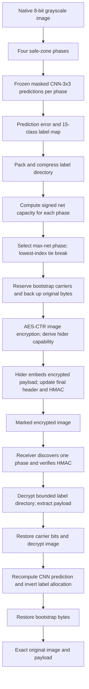
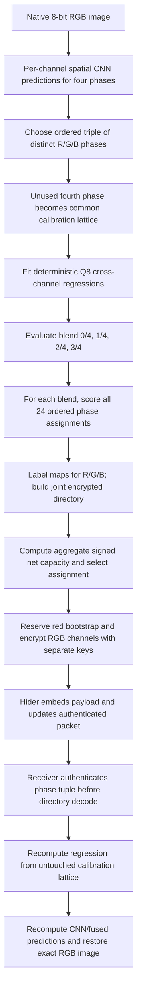

# EDR2 Paper-Writing Evidence Index

**Status snapshot:** 15 November 2026  
**Purpose:** Consolidate the exact protocol definitions, pending experiment evidence, planned tables/figures, comparison boundaries and publication cautions for the RDHEI manuscript. This is an evidence index and method specification—not a results paper. Numerical fields remain blank until run artefacts have been completed and validated.

## 1. Current execution status

| Workstream | Current state | Evidence / run |
|---|---|---|
| Exact six classic grayscale PNG restoration | Not complete. Six source files were converted to grayscale PNG, but their decoded-pixel fingerprints do not match the repository's preserved canonical fingerprints. | Do not label the converted files as the exact canonical baseline. |
| USC-SIPI native grayscale EDR2 | Running. Archive inventory and allowlist curation completed; adaptive EDR2 evaluation is running. | [GitHub Actions run 43635334118](https://github.com/Parzifal25/RDHEI/actions/runs/43635334118) |
| Four fixed-phase grayscale ablation | Queued after adaptive run in the same workflow. | Run 43635334118, subsequent jobs in workflow. |
| USC-SIPI native RGB CC-EDR2-RGB | Running. Regression-test job is in progress; full-corpus job is conditional on tests passing. | [GitHub Actions run 43637437069](https://github.com/Parzifal25/RDHEI/actions/runs/43637437069) |
| RGB four-blend / 24-assignment analysis | Included after successful full-corpus RGB run; analyser fails closed on incomplete evidence. | Run 43637437069. |
| Cryptographic security review | Source-based static review written and committed. It is not an external cryptographer's audit or formal proof. | [SECURITY_REVIEW_EDR2_AND_RGB_2026-11-15.md](https://github.com/Parzifal25/RDHEI/blob/research/edr2-rgb-full-corpus-execution/SECURITY_REVIEW_EDR2_AND_RGB_2026-11-15.md) |

The six classic grayscale images are not part of the native USC-SIPI all-volume corpus evaluation. The RGB corpus is also separate. Do not pool grayscale and RGB results or present the historical 243-image subset as the complete USC-SIPI database.

## 2. Protocol identity and experimental scope

### 2.1 Grayscale EDR2

- Reserve-room-before-encryption (RRBE) design.
- Frozen residual CNN-3×3 predictor; checkpoint is loaded in evaluation mode and gradients are disabled.
- Same-size, two-dimensional, native 8-bit grayscale (`uint8`, mode `L`) only.
- Both dimensions must be even for the current four-phase lattice implementation.
- Owner, hider and receiver stages are separated. The receiver's per-image semantic inputs are the marked encrypted image, 32-byte master key and 128-bit nonce.
- Recovery information (encrypted header, encrypted packed label directory, HMAC, bootstrap-byte backup and payload) is carried in the marked image. The independent hider receives the derived data-hiding capability key; this is keying material, not a label/prediction sidecar.
- No model retraining is performed by these experiments. The model checkpoint remains frozen.

### 2.2 CC-EDR2-RGB

- Separate RGB research protocol; does not replace or modify grayscale EDR2.
- Native 8-bit RGB TIFFs only (`uint8`, H×W×3), with even height and width. No colour conversion, channel reordering, resizing, cropping or 16-bit conversion.
- Frozen grayscale residual CNN-3×3 checkpoint is applied separately to R, G and B planes; no RGB-specific retraining is performed.
- Three distinct safe-lattice phases are assigned to R, G and B. The remaining fourth phase is untouched in all channels and is used as the common cross-channel calibration lattice.
- Cross-channel affine regression coefficients are deterministically recomputed from the untouched calibration lattice; no regression-coefficient sidecar is transmitted.
- The blend ratio and four-phase tuple are stored in the encrypted authenticated joint directory.

## 3. Safe-zone geometry (grayscale and RGB)

Let an image have even dimensions (H\times W), with a 3×3 masked predictor of radius one. For phase (q\in\{0,1,2,3\}), define

\[
r_q=1+\lfloor q/2\rfloor,\qquad
c_q=1+(q\bmod 2),
\]

and candidate centres

\[
\mathcal{G}_q=
\{(y,x): y=r_q+2i,\ x=c_q+2j,\ 1\le y\le H-2,\ 1\le x\le W-2\}.
\]

Equivalently, the implementation enumerates row-major coordinates using step two and a one-pixel image border. Within a phase, any two distinct centres are Chebyshev-separated by at least two pixels. Since the predictor's centre input is masked, modifying any set of candidate centres within that phase does not modify another candidate's 3×3 predictor context.

For a 512×512 image, each phase contains (255\times255=65{,}025) candidate centres, or approximately 24.81% of the image pixels. This is a geometric candidate count, **not** an observed net payload rate.

### Phase/parity sketch

The four cells of each interior 2×2 tile correspond to the four parity phases. Exactly one parity is selected in grayscale. In RGB, three distinct parities are assigned to R/G/B and the fourth is left untouched as the calibration lattice.

```text
Interior parity tile (row parity, column parity)

             column parity
               even   odd
             +------+------+
row even     | q=3  | q=2  |
             +------+------+
row odd      | q=1  | q=0  |
             +------+------+

Grayscale: choose one q for all mutable candidate centres.
RGB:       assign three different q values to R/G/B; reserve the fourth qA.
```

### Manuscript-safe wording

> The safe-zone candidate lattice is a finite-density set of pixel centres constrained by the masked 3×3 predictor receptive field. Four row/column parity phases are considered. The phase selection does not alter the predictor checkpoint or the per-centre prediction rule; it changes only the mutually context-invariant candidate coordinates used for reservation and embedding.

Do not call 24.81% the payload capacity. The gross number of replaceable MSB slots depends on the label class at each candidate; net capacity additionally subtracts metadata-carrier opportunity cost and bootstrap backup.

## 4. Error allocation and safe-zone label map

For candidate pixel (x_i), the owner computes the rounded predictor output (p_i) and absolute prediction error

\[
e_i=|x_i-p_i|.
\]

The EDR2 allocation function maps each integer error (e\in[0,255]) to a tuple

\[
a(e)=(n,\ell,u),
\]

where (n) is the number of replaceable most-significant bits and ([\ell,u]) is the admissible prediction-error interval used by the receiver's uniqueness check.

The set of distinct tuples is lexicographically sorted into a 15-entry codebook. A candidate's label is the index of its tuple in that codebook. Thus the label index is **not** a monotonic ranking of prediction error. Each label is stored in four bits; two labels are packed per byte, high nibble first. If the number of labels is odd, the unused low nibble is zero.

### Exact current codebook

| Label | Prediction-error values mapping to label | Replaceable MSBs (n) | Admissible error interval ([\ell,u]) |
|---:|---:|---:|---:|
| 0 | 128–255 | 0 | [0, 0] |
| 1 | 64 | 0 | [64, 64] |
| 2 | 32 | 1 | [32, 32] |
| 3 | 65–127 | 1 | [65, 127] |
| 4 | 16 | 2 | [16, 16] |
| 5 | 33–63 | 2 | [33, 63] |
| 6 | 8 | 3 | [8, 8] |
| 7 | 17–31 | 3 | [17, 31] |
| 8 | 4 | 4 | [4, 4] |
| 9 | 9–15 | 4 | [9, 15] |
| 10 | 2 | 5 | [2, 2] |
| 11 | 5–7 | 5 | [5, 7] |
| 12 | 1 | 6 | [1, 1] |
| 13 | 3 | 6 | [3, 3] |
| 14 | 0 | 7 | [0, 0] |

**Decoding rule:** after payload-carrier bits have been restored, the receiver retains the low (8-n) bits (the residue). It searches byte values with that residue and requires exactly one value whose error relative to the recomputed prediction lies in ([\ell,u]). A missing or non-unique candidate is a decoding failure. The repository includes exhaustive finite-domain uniqueness checks over every original/prediction byte pair and all payload words admitted by the selected allocation.

**Important:** Keep the exact codebook and its sorted tuple order in the paper. Do not redraw it as an intuitively monotone quantizer; the singleton error classes and lexicographically sorted codebook are part of the implementation.

## 5. Grayscale capacity accounting and phase rule

For a selected phase, let:
- (G=\sum_i n_i): gross replaceable MSB slots across all candidate centres;
- (H_b=20+|D|+32): number of bootstrap carrier candidates, where 20 bytes is the fixed header, (|D|) is the stored directory length in bytes, and 32 bytes is the HMAC-SHA-256 tag;
- (F=\sum_{i=0}^{H_b-1}n_i): ordinary payload slots forfeited because those candidate centres carry the bootstrap;
- (S=G-F): ordinary bitstream length;
- (B=8H_b): original bootstrap bytes backed up in the ordinary bitstream.

The signed net payload is

\[
N_{\mathrm{gray}}=S-B=G-F-8H_b,
\qquad
\mathrm{net\ bpp}=N_{\mathrm{gray}}/(HW).
\]

All four phases are evaluated independently with identical inference batching and checkpoint. The selected phase maximizes signed net payload after the compressed directory, bootstrap opportunity cost and byte backup are included. Ties are resolved by the lowest phase index. Non-positive net capacity remains a rejection; it must not be silently clamped to zero in signed-capacity analysis.

## 6. RGB cross-channel blend and phase-assignment design

For target channel (c\), the other two channels form an integer reference feature

\[
x=\left\lfloor\frac{I_a+I_b+1}{2}\right\rfloor.
\]

On the untouched calibration lattice (q_A), the method fits a deterministic Q8 affine regression for each target channel. The fitted cross-channel estimate is fused with the rounded spatial CNN output:

\[
p=\operatorname{clip}\left(
\operatorname{round}_{\mathrm{even}}
\frac{(d-w)p_{\mathrm{spatial}}+w p_{\mathrm{cross}}}{d},
0,255\right).
\]

The predeclared blends are:

| Blend (w/d) | Interpretation |
|---|---|
| 0/4 | Spatial CNN only; cross-channel ablation baseline |
| 1/4 | 25% cross-channel correction |
| 2/4 | 50% cross-channel correction |
| 3/4 | 75% cross-channel correction |

Three distinct phases are assigned in order to R, G and B. The unused phase is the calibration phase. The number of ordered assignments is (4\times3\times2=24). The adaptive method evaluates all 24 and chooses the assignment with the largest signed aggregate net capacity; ties are resolved lexicographically by the phase tuple. The fixed comparator is assignment (0,1,2), with calibration phase 3.

For a joint RGB bootstrap of (H_b) red-channel candidates, let (G_R,G_G,G_B) be all three channels' gross MSB slots and (F_R) be ordinary slots forfeited by the red bootstrap carriers. Then

\[
S_{RGB}=G_R+G_G+G_B-F_R,\qquad
N_{RGB}=S_{RGB}-8H_b.
\]

RGB net bpp is (N_{RGB}/(HW)), i.e. bits per spatial RGB pixel, with one aggregate payload across the three channels. Do not divide by (3HW), and do not compare it directly with grayscale bpp without clearly labelling the distinct operating context.

The current fail-closed runner requires four blend rows per image, all 24 ordered assignments per blend, and exact image/payload recovery for all distinct payload lengths for every positive-capacity blend. It uses a fresh packet reservation and a packet-specific nonce for every trial. The protocol specification was updated on the RGB execution branch to match this all-blend behavior.

## 7. Experiment evidence required for the manuscript

### 7.1 Native USC-SIPI grayscale

The preparation path downloads the official USC-SIPI volumes (textures, rotate, aerials, misc and sequences), inventories native single-frame 8-bit grayscale TIFFs without conversion, and records archive and file hashes. A separate catalogue curation step:
- rejects files that are not native mode-L uint8 two-dimensional images;
- excludes odd dimensions outside the current EDR2 protocol;
- excludes catalogue maps and calibration charts;
- distinguishes natural images and constructed texture mosaics;
- tags rotated texture families and sequence frames so correlated files are not treated as independent scenes;
- pins the exact source TIFF bytes using SHA-256.

The inventory is not itself the approved evaluation set. The curated hash-pinned allowlist is the evaluation corpus definition. The six classic PNG baseline set is separate and remains missing as exact canonical data.

### 7.2 Grayscale run artefacts

Adaptive evaluation artifact:
- `input_manifest.json`, `corpus.json`, `skipped_inputs.json`, `pixel_duplicates.json`;
- `capacity_summary.csv`: per-image dimensions, source/pixel hashes, candidate count, gross slots, metadata/backup overhead, signed net capacity, bpp, selected phase and all four phase scores;
- `roundtrip_summary.csv`: empty, one-bit, short, partial, near-capacity and full-capacity exact image/payload recovery results;
- `algebra.json`: exhaustive mapping/decoding uniqueness gate;
- `integrity.json`: checkpoint/model immutability;
- `negative_checks_and_rejections.json`: wrong key/nonce, corrupted ciphertext and invalid input checks;
- `run_summary.json`: corpus coverage, accepted/rejected counts and exact-recovery totals.

Matched ablation analysis artifact:
- `phase_ablation_per_image.csv`;
- `phase_ablation_summary.csv`;
- `group_phase_summary.csv`;
- `classification_phase_summary.csv`;
- `correlation_cluster_summary.csv`;
- `correlation_cluster_by_group_summary.csv`;
- `cluster_bootstrap_summary.csv`;
- `analysis_validation.json`;
- `fig01_phase_capacity_boxplot.png`;
- `fig02_phase_selection_gain_histogram.png`;
- `fig03_group_acceptance_counts.png`;
- `fig04_adaptive_vs_phase0_scatter.png`;
- `fig05_cluster_balanced_gain_ci.png` (only when sufficient clusters exist).

The analyser must confirm same file hashes, decoded-pixel hashes and dimensions across adaptive and fixed runs; fixed-phase capacities must reproduce the corresponding per-phase values from the adaptive run; and adaptive capacity must equal the per-image maximum with the declared tie rule.

### 7.3 Native USC-SIPI RGB

The RGB preparer downloads only official USC-SIPI `aerials` and `misc` volumes. Every TIFF candidate is checked against the publisher's published POSIX `cksum` list. Only native mode-RGB, uint8, single-frame, even-dimension images are retained; grayscale, palette, RGBA, 16-bit, odd-sized, and duplicate decoded-pixel files are excluded with reasons. The hash-pinned manifest, not the catalogue's nominal count, is authoritative.

Raw RGB run artifact:
- `rgb_capacity_summary.csv`;
- `rgb_phase_assignment_scores.csv`: 24 ordered assignments for each of four blend settings per image;
- `rgb_roundtrip_summary.csv`: exact image/payload outcomes, by blend and payload boundary;
- `rgb_input_inventory.csv`, `rgb_skipped_inputs.csv`;
- `rgb_run_summary.json`, `rgb_input_manifest.json`, `rgb_source_manifest.json`.

RGB analysis artifact:
- `rgb_per_image_capacity_and_prediction.csv`;
- `rgb_blend_ablation_summary.csv`;
- `rgb_prediction_mae_summary.csv`;
- `rgb_selected_phase_frequency.csv`;
- `rgb_all_24_phase_assignments_per_image.csv`;
- `rgb_exact_recovery_summary.csv`;
- `fig_rgb_01_capacity_by_blend.png`;
- `fig_rgb_02_prediction_mae.png`;
- `fig_rgb_03_phase_selection_gain.png`;
- `CC_EDR2_RGB_FINAL_REPORT.md`;
- `analysis_provenance.json`.

The RGB analyser rejects a run unless run status is `completed`, `analysis_ready` is true, all input files are covered, there are no failed round trips, each blend is accounted for, and every image/blend has the 24 distinct ordered phase assignments.

## 8. Recommended paper figures and tables

| Paper item | Content | Source artifact / evidence |
|---|---|---|
| Fig. 1 | Overall EDR2 owner–hider–receiver pipeline and receiver inputs | Protocol diagrams below; `PROTOCOL_EDR2.md` |
| Fig. 2 | Four-phase grayscale safe-zone lattice and masked 3×3 receptive-field argument | `wire.py`, `predictor.py`; geometry in Section 3 |
| Fig. 3 | Prediction-error-to-label codebook and packed directory construction | `wire.py`, `predictor.py`; exact table in Section 4 |
| Fig. 4 | RGB phase-staggered R/G/B lattices plus untouched calibration lattice | `PROTOCOL_EDR2_RGB.md` |
| Fig. 5 | RGB four-blend comparison and channel-wise prediction MAE | RGB analysis figures 01–02 |
| Fig. 6 | Adaptive versus fixed-phase capacity and per-image gain | Grayscale analysis figures 01, 02 and 04 |
| Fig. 7 | Corpus composition and acceptance/rejection by source stratum | Grayscale figure 03 and corpus manifests |
| Table 1 | Notation and receiver/party information model | Protocol specifications |
| Table 2 | Exact safe-zone allocation/label codebook | Section 4 above |
| Table 3 | Dataset provenance, source hashes, dimensions, exclusions and correlation clusters | USC-SIPI manifests and capacity CSVs |
| Table 4 | Grayscale signed net-capacity accounting and accepted/rejected image counts | `capacity_summary.csv` |
| Table 5 | Fixed phase 0–3 versus adaptive phase: per-image paired and aggregate results | `phase_ablation_*.csv` |
| Table 6 | Correlation-cluster and group-wise phase gains with cluster bootstrap intervals | `correlation_cluster_summary.csv`, `cluster_bootstrap_summary.csv` |
| Table 7 | RGB blend 0/4, 1/4, 2/4, 3/4: signed net bpp, acceptance and exact recovery | `rgb_blend_ablation_summary.csv` |
| Table 8 | RGB spatial/cross/fused prediction MAE by channel and blend | `rgb_prediction_mae_summary.csv` |
| Table 9 | RGB 24-assignment phase search versus fixed (0,1,2) | `rgb_all_24_phase_assignments_per_image.csv` and per-image capacity CSV |
| Table 10 | Payload boundary recovery and negative/tamper checks | Grayscale/RGB roundtrip and negative-check ledgers |
| Table 11 | Related-work mechanism/assumption matrix; published rates labelled non-comparable | `EDR2_LITERATURE_COMPARISON.md` |

All numerical table cells above must be populated from completed run artifacts, not estimated from code or earlier experiments.

## 9. Process diagrams

### 9.1 Grayscale EDR2 owner–hider–receiver path



### 9.2 CC-EDR2-RGB phase and prediction path



## 10. Related-work comparison boundaries

The repository's literature matrix is contextual prior art, not a matched implementation benchmark. Important boundaries to retain:

- CNN prediction, prediction-error coding, MSB replacement, compressed label/location maps, RRBE, adaptive partitioning, authenticated RDHEI and net-rate accounting are established ingredients. Do not claim any one of these alone as the novelty.
- Recent grayscale RDHEI comparators include prediction-error authentication/compression, deep-feature-guided prediction, and hierarchical bit-plane compression. Their reported native embedding rates are not directly comparable with EDR2 signed net bpp until denominator, dataset, bootstrap/metadata costs, and receiver side-information assumptions are harmonized.
- Encrypted-colour RDH using cross-channel correlation was already reported by Li et al. (2021), DOI [10.1016/j.jvcir.2021.103166](https://doi.org/10.1016/j.jvcir.2021.103166). Cross-channel prediction in plaintext colour RDH is older. Therefore RGB support, cross-channel correlation and predictor fusion are not standalone novelty claims.
- The candidate grayscale distinction is the specific maximum-density safe lattice constrained by the fixed masked 3×3 receptive field, four-phase signed-net selection, and authenticated in-band phase discovery.
- The candidate RGB distinction is the co-design of disjoint per-channel safe lattices, an untouched shared calibration lattice, deterministic receiver-recomputed cross-channel regression, and authenticated joint phase assignment.
- Those are candidate contributions only. The related-work matrix does not prove global novelty. Full-text review of the closest methods is still required.
- No numerical superiority claim is supported without matched reimplementations on identical decoded source pixels and common net-capacity accounting.

Reference matrix: [EDR2_LITERATURE_COMPARISON.md](https://github.com/Parzifal25/RDHEI/blob/research/edr2-rgb-full-corpus-execution/EDR2_LITERATURE_COMPARISON.md)  
Research positioning: [EDR2_RESEARCH_POSITIONING.md](https://github.com/Parzifal25/RDHEI/blob/research/edr2-rgb-full-corpus-execution/EDR2_RESEARCH_POSITIONING.md)

## 11. Cryptographic review and claims boundary

The source-based static review is committed at [SECURITY_REVIEW_EDR2_AND_RGB_2026-11-15.md](https://github.com/Parzifal25/RDHEI/blob/research/edr2-rgb-full-corpus-execution/SECURITY_REVIEW_EDR2_AND_RGB_2026-11-15.md).

Positive code findings include HKDF context separation, separate keys for image/directory/payload/header/authentication, per-channel RGB image keys, HMAC-SHA-256 over packet content and phase/dimensions, constant-time tag comparison, and authenticated bounded directory parsing.

The review also records these limitations:
1. Benchmark keys are public test material; the runs do not demonstrate confidentiality.
2. Nonce uniqueness is required under each master key and is not persistently enforced by the production API.
3. The hider's derived capability also yields the HMAC key, so a malicious authorized hider can forge a valid tag; the HMAC does not prove owner-only origin.
4. There is no application replay-state mechanism.
5. Owner-to-hider key delivery, lifecycle, revocation and rotation are assumed, not implemented.
6. The custom AES-CTR/HMAC packet construction has no formal protocol security proof in this project.
7. This review is not an independent external cryptographer's audit.

Use manuscript wording that describes the implemented primitives and assumptions. Do not state that the protocol is formally proven, replay-resistant, certified, or independently audited.

## 12. Open publication blockers

- The two native USC-SIPI workflow runs must finish successfully and their complete artifacts must be inspected.
- The exact six classic grayscale PNGs remain un-restored; do not use the converted substitutes as canonical baseline files.
- Confirm the frozen checkpoint SHA-256 and training provenance from preserved records. The checkpoint is frozen and no retraining occurred during these evaluations; do not invent absent historical training logs.
- Complete targeted full-text novelty comparison for the exact safe-set predicate and authenticated phase-location procedure.
- Obtain an external independent cryptographic review before any production-security claim.
- Keep EDR1, grayscale EDR2, RGB EDR2, the historical 243-image experiment, the six classic image baseline, and the native USC-SIPI corpora as separate evidence sets unless a deliberately matched experiment explicitly joins them.

## 13. Source files of record

- Grayscale protocol: `final_rdhei_protocol_gate_20261022/PROTOCOL_EDR2.md`
- Grayscale lattice, allocation, packet framing: `final_rdhei_protocol_gate_20261022/wire.py`
- Grayscale predictor, packing, phase selection: `final_rdhei_protocol_gate_20261022/predictor.py`
- Grayscale owner/receiver: `final_rdhei_protocol_gate_20261022/protocol.py`
- Grayscale dataset inventory and curation: `prepare_usc_sipi_gray.py`, `curate_usc_sipi_allowlist.py`
- RGB protocol: `final_rdhei_protocol_gate_20261022/PROTOCOL_EDR2_RGB.md`
- RGB packet framing and channel-separated key derivation: `final_rdhei_protocol_gate_20261022/rgb_wire.py`
- RGB channel prediction and phase assignment: `final_rdhei_protocol_gate_20261022/rgb_protocol.py`
- RGB source validation: `final_rdhei_protocol_gate_20261022/prepare_usc_sipi_rgb.py`
- RGB experiment runner and analyser: `run_rgb_gate.py`, `analyze_rgb_evidence.py`
- Security review: `SECURITY_REVIEW_EDR2_AND_RGB_2026-11-15.md`

---

**Paper-writing gate:** start drafting only after the native grayscale adaptive + four fixed-phase analysis and native RGB full-corpus + four-blend/24-assignment analysis artifacts are complete, inspected, and their reported validation flags pass. This index intentionally contains protocol and plotting plans but no invented empirical result values.
