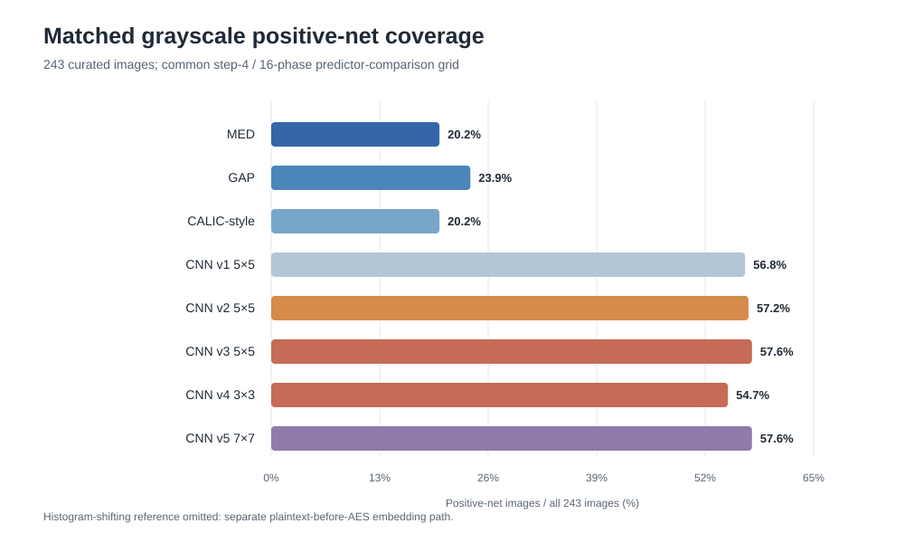
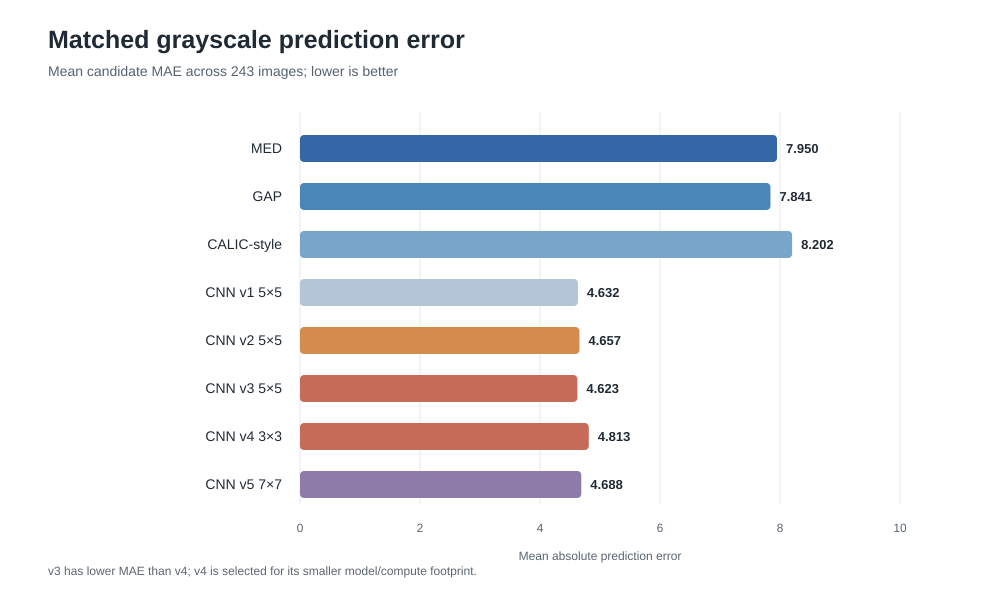
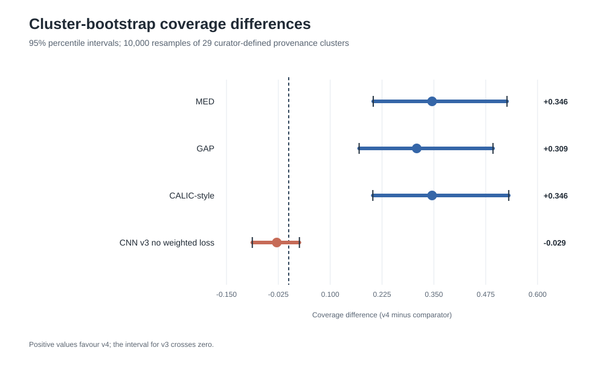
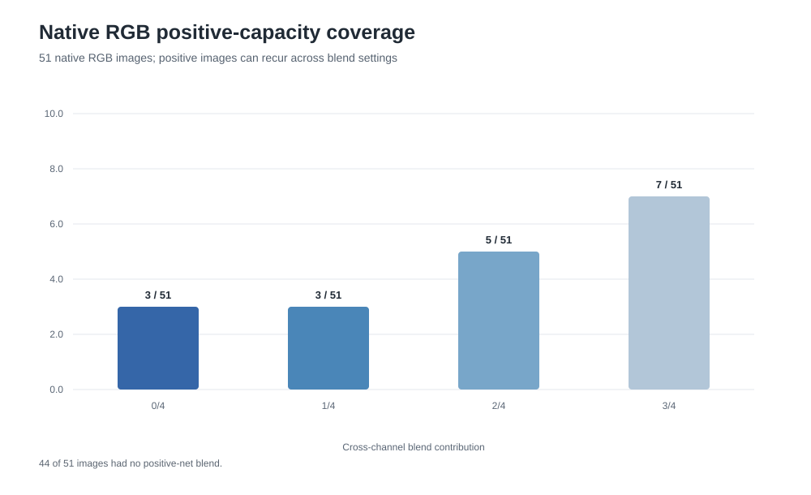
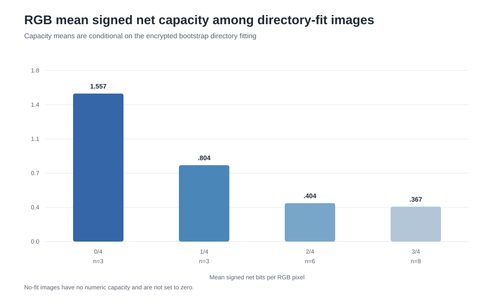
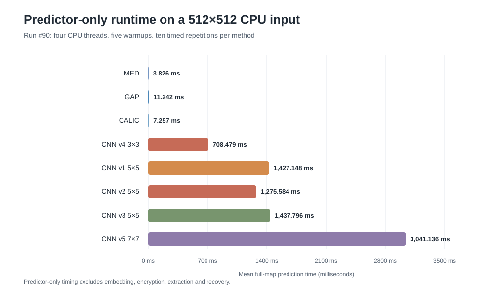
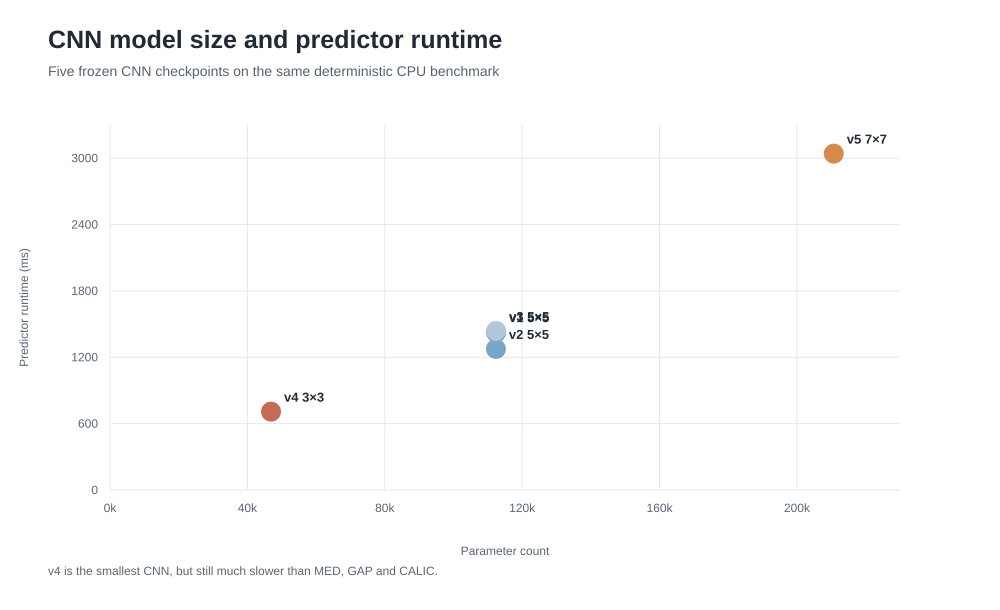
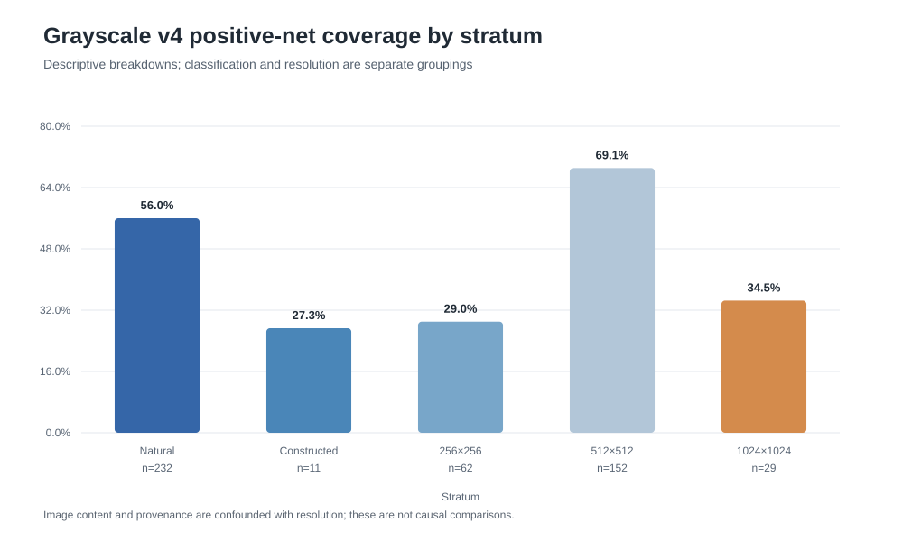
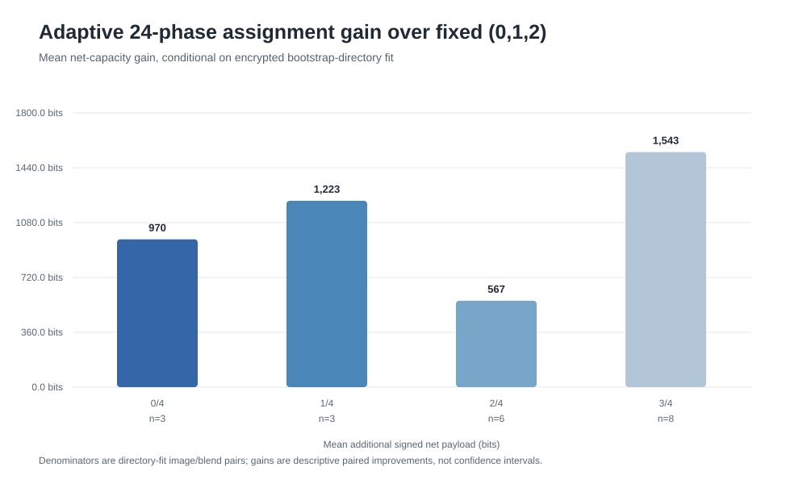
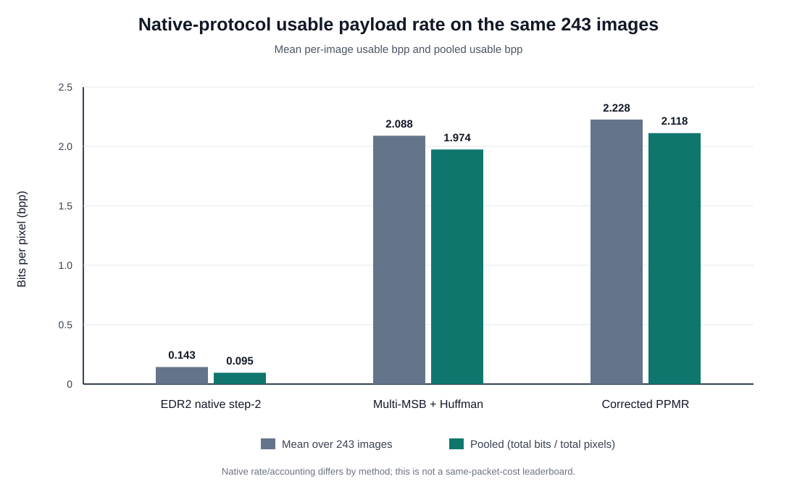

# Context-Invariant CNN Prediction for Reversible Data Hiding in Encrypted Images: Protocol, Full-Corpus Evaluation, and Native-Protocol Baselines

**Manuscript draft — 2026-11-20**  
**Status:** updated with the completed 243-image external-baseline comparison; still requires author, reference, rights, and independent security review before submission.  
**Author and affiliation details:** to be confirmed by the authors.

## Abstract

This paper studies a convolutional-neural-network (CNN) predictor for reversible data hiding in encrypted images (RDHEI), focusing on receiver-side prediction synchronization and explicit accounting for in-band recovery overhead. The grayscale EDR2 protocol uses a frozen residual CNN with a masked 3×3 neighbourhood and a step-2 safe lattice. Four maximum-density lattice phases are evaluated independently, and the owner selects the phase with the greatest signed net payload after charging the encrypted header, compressed label directory, authentication-tag carrier opportunity cost, and bootstrap-byte backup. The selected phase is indicated by authenticated in-band framing; the receiver's per-image semantic inputs are the marked encrypted image, a 32-byte master key, and a 128-bit nonce.

On a curated corpus of 243 hash-verified native 8-bit grayscale USC-SIPI images, EDR2 achieved positive signed net capacity on 163 images and passed 978/978 exact image-and-payload receiver trials among accepted positive-capacity images. In a separate matched predictor study, the proposed 3×3 checkpoint achieved 133/243 positive-net outcomes and mean candidate MAE 4.8130; it improved on MED, GAP, and a simplified CALIC-style implementation under that study's common step-4/16-phase grid, but did not outperform the 5×5 no-weighted-loss CNN ablation, which achieved 140 positive outcomes and MAE 4.6233. The 3×3 model is retained as a smaller model/compute trade-off, not as the most accurate predictor.

Two external RDHEI methods were also evaluated on the same 243 exact source files and decoded pixel arrays. Multi-MSB prediction with Huffman coding achieved 243/243 exact payload and host recoveries, positive native net payload on 243/243 images, a mean usable rate of 2.0885 bpp, and a pooled usable rate of 1.9735 bpp. Corrected PPMR achieved 243/243 exact payload and host recoveries, positive native net payload on 238/243 images, a mean usable rate of 2.2282 bpp, and a pooled usable rate of 2.1182 bpp. EDR2's corresponding mean and pooled usable rates were 0.1432 and 0.0955 bpp. These are matched-corpus, native-protocol results rather than a same-packet-cost leaderboard: each implementation retains its own embedding construction and native overhead expression. PPMR used four disclosed, narrowly scoped compatibility corrections in a temporary copy of its pinned upstream source.

A separate RGB research prototype evaluated 51 native RGB images, four spatial/cross-channel blend settings, and all 24 ordered channel-phase assignments. Seven images achieved positive net capacity under at least one blend, and all 162 exact-recovery trials over positive image/blend pairs passed. A reproducible CPU benchmark measured the 3×3 full-map predictor at 708.5 ms for a synthetic 512×512 input, about 185 times the measured MED runtime. A native-image end-to-end benchmark on USC-SIPI image 5.2.08.tiff measured a mean 2.506 s over ten repeats, with 10/10 exact recoveries and a sampled incremental RSS peak of 16.59 MiB. A 20,000-input coverage-guided parser campaign completed without a reported crash, alongside deterministic adversarial packet tests. The RGB extension remains exploratory. The work establishes implementation-level evidence under the tested conditions; it does not establish state-of-the-art capacity, a formal security proof, or independent cryptographic certification.

**Keywords:** reversible data hiding; encrypted images; CNN prediction; safe lattice; bit-plane replacement; in-band metadata; exact recovery; RGB image processing.

## 1. Introduction

Reversible data hiding (RDH) embeds auxiliary data into a host signal while allowing exact recovery of both the embedded message and the original host. In encrypted-image RDH, the system must additionally distinguish the responsibilities of the content owner, data hider and receiver. Early RDHEI work established encrypted-domain data hiding and separable recovery, while reserve-room-before-encryption (RRBE) became an influential architecture for making reversible capacity available before image encryption [1,2].

Prediction-based approaches exploit spatial correlation: a predictor estimates a pixel from its neighbourhood, and a small prediction error can permit replacement of selected most significant bits (MSBs) while retaining enough information to recover the original value. CNN predictors offer a way to learn local prediction functions, but their use introduces a synchronization problem. If data embedding changes pixels that appear in the predictor's receptive field, the sender and receiver may no longer obtain identical predictions.

This paper studies a context-invariance construction for a masked 3×3 predictor. Only candidate centres on one of four step-2 lattices may be altered, and the candidate centre is masked during prediction. Since all distinct mutable centres in the selected lattice are Chebyshev-separated by at least two, no other mutable centre enters a candidate's 3×3 masked patch. Under fixed checkpoint weights, inference mode, preprocessing and rounding, the prediction input at each candidate is therefore unchanged by modifications to candidate-centre values.

Prior art substantially constrains the novelty claim. Yi and Zhou's adaptive checkerboard-based prediction (ACBP) already predicts three-quarters of pixels from a one-quarter reference set and combines this with adaptive bit-level embedding; exact recovery is reported at \(\varepsilon=1\), while the reported maximum of 4.5 bpp occurs at \(\varepsilon=255\), with nonzero recovered-image distortion [11]. Ping et al. subsequently introduced an asymmetric CNN predictor and adaptive-mean second stage for RDHEI [12]. Cheng et al. used a pixel-level masked autoencoder and polar coding in a VRAE design [13]. Thus checkerboard occupancy, bit replacement, CNN prediction for RDHEI and masked-pixel prediction are not claimed as new. More recent work includes MSB sharing with overlapping sawtooth partitions [4], adaptive bit-plane classification/group coding [5], D4-symmetry pixel shifting with context-aware recovery [6], and overlapping-block/shared-MSB encoding [7].

Ren et al. (2025) proposed an RDHEI scheme combining an improved gradient-adjusted predictor (ISGAP), adaptive Huffman compression of prediction errors and separate plaintext/ciphertext authentication. Their experiments used 100 images from each of BOSSBase and BOWS-2 and report average embedding rates of 3.39 bpp and 3.27 bpp, respectively, with exact image recovery [15]. This is relevant because it combines prediction-error compression with authentication, although its predictor, embedding architecture and accounting differ from EDR2.

Recent RRBE systems also exploit global zero high-order bit-plane runs, adaptive hierarchical block variable-length coding, capacity-aware block rearrangement and CP-ABE-based recovery authorization on BOSSBase, BOWS-2 and UCID [14]. The accessible article abstract establishes the method and datasets but does not state a numerical rate; no rate is inferred here.

**Table 1.** Closest published RDHEI comparators and the boundary of comparison.

| Closest published comparator | Core mechanism and evaluation reported by the source | Numerical result quoted here | Comparability boundary |
|---|---|---|---|
| Yi and Zhou (2018), ACBP/PRDHEI [11] | Checkerboard reference set predicts three-quarters of pixels; adaptive bit-level embedding replaces bits. | Fully reversible at ε=1. At ε=255, maximum 4.5 bpp with recovered-image average PSNR above 32 dB. | The 4.5-bpp point is not lossless; it must not be compared as an exact-recovery capacity. |
| Ping et al. (2024) [12] | Asymmetric CNN plus adaptive-mean second-stage predictor; BOSSBase, UCID, BOWS-2 and six standard images. | No numerical rate reproduced in this draft. | CNN prediction for RDHEI is established prior art; method-specific extraction and recovery differ. |
| Cheng et al. (2025) [13] | Pixel-level masked autoencoder with polar coding in a VRAE design. | No numerical rate reproduced in this draft. | Masked-pixel learned recovery is prior art, but VRAE/polar-code results are not a direct RRBE comparison. |
| Ren et al. (2025) [15] | ISGAP prediction-error compression and plaintext/ciphertext authentication; 100 images each from BOSSBase and BOWS-2. | Average 3.39 bpp and 3.27 bpp, respectively. | Dataset, predictor, embedding path and rate accounting differ from EDR2. |
| Zhou et al. (2026), BCAGC [5] | Bit-plane classification and adaptive group coding; BOSSBase, BOWS-2 and UCID. | Average 4.1472, 4.0565 and 3.4465 bpp, respectively. | The published rates are not matched to EDR2's USC-SIPI corpus or signed net-capacity ledger. |
| Peng et al. (2026) [14] | Dual-stage bit-plane compression, adaptive hierarchical block variable-length coding, block rearrangement and CP-ABE recovery authorization; BOSSBase, BOWS-2 and UCID. | No numerical rate reproduced in this draft. | Highly relevant bit-plane/RRBE comparator; detailed full-paper tables still require extraction and protocol normalization. |
| Yin, Xiang and Zhang (2020), Multi-MSB+Huffman [17] | Multi-MSB prediction with Huffman-coded location information and encrypted-domain data embedding. Public implementation reproduced on the same 243-image USC-SIPI corpus. | 2.088477 mean usable bpp; 1.973505 pooled usable bpp; 243/243 exact payload and host recoveries. | Direct matched-corpus reproduction using the native method rate; carrier geometry and overhead expression are not identical to EDR2. |
| Yin et al. (2021), PPMR [18] | Pixel prediction, multi-MSB planes rearrangement and UB/NUB block embedding. Public implementation reproduced on the same 243-image corpus with four disclosed temporary compatibility corrections. | 2.228173 mean usable bpp; 2.118172 pooled usable bpp; 243/243 exact payload and host recoveries. | Direct matched-corpus result labelled corrected PPMR; not an unmodified-source result or same-packet-cost comparison. |

The published rates in the first six rows are literature-side context, not matched experiments. The final two rows are direct reproductions on the same 243 native images as EDR2. They retain their respective native rate expressions and carrier geometries, so the comparison is paired by image but is not a same-packet-cost or same-security-model leaderboard. EDR2 charges its in-band directory, authentication-carrier and bootstrap-restoration costs; the external methods retain their original auxiliary-data and reservation conventions. No claim of quantitative superiority is made for EDR2.

The candidate contribution here is narrower: a deterministic local input-invariance condition for a frozen, centre-masked 3×3 CNN under a step-2 separated candidate-centre phase, coupled to an overhead-aware four-phase signed-net selection rule. The project also provides an authenticated in-band packet, two direct external reproductions on the same 243-image corpus, and an evaluated RGB variant. These are candidate contributions to defend; they are not evidence that the general checkerboard, CNN, masking or bit-replacement ideas are first-of-kind.

The second design concern is accounting. Gross replaceable bits are not payload capacity. The protocol charges the ordinary slots lost to the in-band header/directory/tag carriers and the additional bits required to preserve the original bootstrap candidate bytes. We therefore use signed net capacity and explicitly report the terms in its accounting identity.

The paper also reports a separate RGB research prototype. The RGB extension assigns three distinct lattice phases to the R, G and B channels and keeps the remaining phase untouched for deterministic cross-channel regression fitting. It is evaluated as an extension experiment, not as a mature or broadly feasible replacement for grayscale EDR2.

## 2. Contributions and scope

The evidence-supported contributions are:

1. **A context-invariant candidate geometry for a masked 3×3 CNN.** Four step-2 phases are alternatives over the valid interior grid. Each phase reaches the 2×2-tile upper bound for the stated radius-one noninterference condition.
2. **Adaptive phase selection under explicit signed net-capacity accounting.** The owner evaluates each phase and selects the greatest signed net payload after metadata-carrier opportunity cost and bootstrap restoration bits. The authenticated header location identifies the selected phase without a phase sidecar.
3. **An in-band EDR2 packet and receiver contract.** Recovery information is stored in the marked encrypted image; the receiver's per-image semantic inputs are the marked image, master key and nonce. The packet uses separated key domains and an authentication tag checked before label-directory decompression.
4. **A matched grayscale predictor/ablation study and native end-to-end evaluation.** Classical predictors and five fixed CNN checkpoints are evaluated under a common comparison grid; native EDR2 is separately tested over the curated grayscale corpus.
5. **A matched-corpus external-protocol comparison.** Public Multi-MSB+Huffman and corrected PPMR implementations are evaluated on the same 243 native grayscale images with exact payload and host recovery checks and explicitly disclosed native rate definitions.
6. **An exploratory RGB extension.** A phase-staggered RGB variant combines a frozen spatial CNN predictor with a deterministic cross-channel regression predictor, and exhaustively tests the 24 ordered channel phase assignments and four blend values.

These are implementation and evaluation contributions. The paper does not claim that CNN-based RDH, RRBE, MSB replacement, prediction-error classification, adaptive block/phase selection, compressed in-band maps, RGB prediction or phase assignment are individually new. The novelty boundary against recent RDHEI work must be supported by a careful prior-art comparison and not by a claim of first use.

## 3. Methodology

### 3.1 Grayscale protocol overview

Let the native grayscale image be \(I\in\{0,\ldots,255\}^{H\times W}\), where both dimensions are even under the current implementation. The fixed 3×3 CNN predicts candidate pixel values from a masked neighbourhood. The predictor checkpoint and inference configuration are common protocol software and are not transmitted per image.

For a candidate centre \((y,x)\), the centre value is masked before CNN inference. Let \(G_q\) denote the candidate coordinates for phase \(q\in\{0,1,2,3\}\). The phase offsets are

\[
r_q=1+\left\lfloor q/2\right\rfloor,\qquad
c_q=1+(q\bmod 2),
\]

\[
G_q=\{(r_q+2i,c_q+2j):(r_q+2i,c_q+2j)\in
\{1,\ldots,H-2\}\times\{1,\ldots,W-2\},\ i,j\in\mathbb{Z}_{\geq0}\}.
\]

For any two distinct centres \(g,g'\in G_q\), the design enforces

\[
\lVert g-g'\rVert_\infty\geq2.
\]

No other mutable centre can occur within the candidate's 3×3 patch. Since its own centre is masked, arbitrary modifications to all selected carrier centres leave every masked predictor input unchanged. This establishes an input-geometry invariance property, conditional on identical model weights, inference mode, numerical preprocessing and rounding.

**Candidate-density bound.** The valid interior coordinates form a rectangle with \((H-2)(W-2)\) positions. Partition it into disjoint 2×2 tiles. At most one centre in each tile can be selected under the Chebyshev-separation condition, so

\[
|G_q|\leq
\left\lceil\frac{H-2}{2}\right\rceil
\left\lceil\frac{W-2}{2}\right\rceil.
\]

Each of the four parity-offset step-2 phases attains this bound for the supported even dimensions. For a 512×512 image, this gives \(255\times255=65{,}025\) candidate centres per phase. This is a geometric density bound, not a positive-payload guarantee: directory, authentication and bootstrap-restoration overhead can still make signed net capacity nonpositive.

The candidate's absolute prediction error is mapped to an allocation label that determines the number of replaceable MSBs and an admissible recovery interval. A four-bit label codebook is packed two labels per byte. The packed directory is compressed using zlib level 9 only when compression shortens the representation.

### 3.2 Adaptive phase and signed net capacity

For each phase, let \(G_0\) be the number of gross ordinary replaceable slots, \(F\) the ordinary slots forfeited by metadata-carrier use, \(H_b\) the number of bootstrap carrier bytes, and \(B=8H_b\) the bits needed to preserve the original bootstrap bytes. The signed net payload is

\[
N=G_0-F-B=G_0-F-8H_b.
\]

The owner evaluates all four phases independently, including directory compression, and chooses the phase with maximum \(N\), with the lowest phase index resolving ties. The protocol rejects the image when the maximum \(N\) is nonpositive. Net bpp is \(N/(HW)\). Gross slots, metadata wire-storage bits, foregone ordinary slots and backup bits are separately recorded to avoid double counting.

### 3.3 Encrypted packet and receiver

The EDR2 header contains a magic identifier, directory codec, reserved bytes, encrypted directory length and payload length. It is followed by the encrypted packed label directory and a 32-byte HMAC-SHA256 tag. The packet authenticates the image dimensions, selected phase and marked image bytes, with the tag carrier bytes zeroed for authentication calculation.

A 32-byte master key \(K\) and 128-bit nonce \(V\) feed HKDF-SHA256. Domain-separated keys are derived for image encryption and the data-hiding capability; the capability is further separated into bootstrap-header, final-header, directory, payload and authentication keys. AES-256-CTR is used with distinct derived keys, and HMAC-SHA256 provides the separate packet-integrity check. The same master-key/nonce context must never be reused for another packet.

The owner reserves room and encrypts the reserved image before the independent hider receives the reserved encrypted image, the payload and its data-hiding capability. The hider inserts encrypted payload bits into the designated ciphertext slots and updates the authenticated header/tag without access to the original image or image-encryption key. The receiver discovers the phase from authenticated in-band framing, verifies the tag, decrypts and validates the directory, extracts the payload and reconstructs the original image. Its per-image semantic inputs are the final marked encrypted image, \(K\) and \(V\); shared decoder/checkpoint software is installed.

### 3.4 RGB extension

For RGB input \(I\in\{0,\ldots,255\}^{H\times W\times3}\), the extension assigns three distinct phase lattices to R, G and B and reserves the fourth as a calibration lattice. All 24 ordered R/G/B assignments are evaluated. For each target channel \(c\), the reference feature at a calibration coordinate is the rounded mean of the other two channels,

\[
x=\left\lfloor\frac{I_a+I_b+1}{2}\right\rfloor,
\]

where \(a,b\) denote the two non-target channels. The target-channel values on the untouched calibration lattice form the regression targets \(y\). Let \(n\) be the number of calibration samples and define the integer sums \(s_x=\sum x\), \(s_y=\sum y\), \(s_{xx}=\sum x^2\), and \(s_{xy}=\sum xy\). The deterministic Q8 affine regression coefficients are

\[
m_{\mathrm{num}}=n s_{xy}-s_xs_y,\qquad
m_{\mathrm{den}}=n s_{xx}-s_x^2,
\]

\[
m_{Q8}=
\begin{cases}
0,&m_{\mathrm{den}}=0,\\
\operatorname{round}_{\mathrm{even}}\left(256\frac{m_{\mathrm{num}}}{m_{\mathrm{den}}}\right),&\text{otherwise},
\end{cases}
\qquad
b_{Q8}=\operatorname{round}_{\mathrm{even}}\left(\frac{256s_y-m_{Q8}s_x}{n}\right).
\]

At an embedding candidate, the cross-channel estimate is

\[
p_c=\operatorname{clip}_{[0,255]}
\left(\operatorname{round}_{\mathrm{even}}\frac{m_{Q8}x+b_{Q8}}{256}\right).
\]

The receiver recomputes the same integer sums and Q8 coefficients from the untouched calibration lattice; no per-image regression coefficients are transmitted. The frozen grayscale CNN checkpoint is applied independently to each RGB channel. For spatial prediction \(p_s\), cross-channel prediction \(p_c\), and blend numerator/denominator \(a/d\), the fused prediction is

\[
p=\operatorname{clip}_{[0,255]}
\left(
\operatorname{round}_{\mathrm{even}}
\left(\frac{(d-a)p_s+ap_c}{d}\right)
\right).
\]

The tested settings are \(a/d\in\{0,1/4,2/4,3/4\}\). The R3D2 packet authenticates the blend ratio and four-phase tuple in the encrypted directory and derives distinct image-encryption keys for the R, G and B channels. The extension remains a research prototype; the present 51-image run demonstrates feasibility only for a minority of the corpus.

## 4. Experimental protocol

### 4.1 Datasets

The grayscale corpus contains 243 curated, unique, native 8-bit USC-SIPI images. The five source volumes were acquired as native TIFF archives. The preparation pipeline retains only single-frame, two-dimensional, 8-bit grayscale images without resizing, cropping, recompression or colour conversion. The final native EDR2 allowlist pins archive and file SHA-256 values, source archive members, dimensions, catalogue group and curation rationale. The allowlist contains 245 candidate files before exact decoded-pixel deduplication; two duplicate pixel arrays are removed, leaving 243 evaluated images. The native EDR2 and matched-predictor runs have exactly the same 243 decoded-pixel SHA-256 values. An earlier matched-run manifest labelled 232 records natural and 11 constructed; the final native allowlist applies the more restrictive catalogue interpretation and labels 239 natural and four constructed. The matched predictor's natural/constructed subgroup values in this manuscript have been recomputed against the final native labels, while the 29-cluster bootstrap retains the matched-run provenance clusters for the same image set.

**Table 2.** Final grayscale corpus strata after hash-based deduplication and catalogue reconciliation.

| Grayscale corpus stratum | Images |
|---|---:|
| Texture scans and mosaics (natural-labelled) | 58 |
| Constructed texture mosaics (separate label) | 4 |
| Rotated texture series | 91 |
| Miscellaneous monochrome | 22 |
| Monochrome aerial | 1 |
| Monochrome sequence frames | 67 |
| **Total** | **243** |

The grayscale resolution distribution is 62 images at 256×256, 152 at 512×512 and 29 at 1024×1024. The final native allowlist records 239 natural-labelled and four constructed texture mosaic images. The image families are correlated observations and should not be treated as independent photographs. The 29 correlation clusters used for the matched bootstrap are retained from the same exact 243-pixel-hash image set.

Catalogue-based exclusions include the segmentation-information maps texmos2.s512 and texmos3.s512, the 5.1.13 resolution/calibration chart, the gray21.512 calibration step wedge and the ruler.512 pixel ruler. The format policy also rejects colour or higher-bit-depth data from the grayscale set, multi-frame TIFFs, odd-dimension inputs outside the current EDR2 protocol, unrecognized catalogue volumes and exact decoded-pixel duplicates. The excluded-candidate ledger is retained in the preparation manifest.

The separate RGB corpus contains 51 distinct native 8-bit RGB images: 37 aerial-colour images and 14 miscellaneous-colour images. Its resolution distribution is 8 images at 256×256, 18 at 512×512, 24 at 1024×1024 and one at 2250×2250. RGB data are not converted to grayscale or resized. The per-image source manifest records official archive checksums and source-file hashes.

**Copyright and reuse.** USC-SIPI describes the database as intended for research, but states that it does not hold copyright for many images and that the copyright status of many items is unknown; it also cautions that it often cannot grant publication permission. Accordingly, access to the dataset is not treated as a blanket redistribution or figure-reuse licence. Before submission, each source image selected for a qualitative manuscript panel must be checked against its item-level provenance and rights status and cleared with the publisher where needed. Unless rights are documented, the paper will use derived plots and author-generated visualisations rather than reproducing source photographs; source-image files will not be bundled with the supplement.

### 4.2 Baselines and ablations

The matched grayscale predictor comparison includes MED, GAP, a simplified CALIC-style predictor and CNN variants v1–v5. All methods use the same step-4 / 16-phase comparison grid for that experiment. The histogram-shift reference is reported separately because its embedding construction and encryption order differ.

Two external encrypted-image RDH baselines were separately reproduced on the native 243-image grayscale corpus: (i) Multi-MSB prediction and Huffman coding, pinned to upstream commit `1e69ae2713dededa56595ff09255cda1e17896d9`; and (ii) pixel prediction and multi-MSB planes rearrangement (PPMR), pinned to upstream commit `21f397890289049798ced0f98d1482d629f93b06`. Each implementation was run on the exact same 243 hash-verified source TIFFs without resizing or colour conversion. The original method-specific embedding and rate calculations were retained; no CNN training or EDR2 checkpoint modification was performed.

For Multi-MSB+Huffman, the reported payload is the actual number of secret bits returned as embedded by the pinned implementation after its location-map side information and reference-pixel reservations. For PPMR, the native `Main612.m` rate expression was retained: gross UB and NUB embedded bits less the compressed prediction-map length and the stated fixed overhead of `8 + 16×8 + 16×8` bits, divided by the image pixel count. The PPMR source required four documented compatibility corrections in a temporary checkout only: independent bit-plane-7/8 control-flow boundaries in encryption and decryption, and active-plane-order corrections in UB and NUB extraction. These changes and before/after source hashes are archived. Results are therefore labelled **corrected PPMR**, not unmodified upstream execution.

The CNN variants comprise:
- v1: 5×5 residual CNN;
- v2: 5×5 CNN without residual connection;
- v3: 5×5 residual CNN trained without weighted loss;
- v4: proposed 3×3 residual CNN;
- v5: 7×7 residual CNN.

No training or fine-tuning was performed during the reported end-to-end evaluations.

### 4.3 External-baseline reproduction protocol

The two external methods were run on the identical 243-image native grayscale corpus used by EDR2. The corpus package pins source-file SHA-256 and decoded-pixel SHA-256 values, and the final joined ledger verifies all 243 identities per method. Multi-MSB+Huffman was executed from its pinned source in GNU Octave. PPMR was executed from its pinned source with the four temporary compatibility changes described above; each change is disclosed with SHA-256 hashes. The 40 deterministic PPMR shards were merged only after per-shard and corpus-wide image-ID validation. Both external methods were required to pass exact payload extraction and exact original-host reconstruction for every image. No model was retrained and the frozen EDR2 checkpoint was not modified.

For aggregate comparison, the common operational estimand is usable native net payload bpp per image: nonpositive net capacity is assigned zero, and any failed exact-recovery row would also be assigned zero. EDR2 signed net bpp is separately retained, including negative outcomes. We report the unweighted mean over all 243 images and the pooled rate (total usable payload bits divided by total pixels). Paired differences use the same image IDs and a cluster bootstrap over the 29 provenance/correlation clusters (10,000 replicates; seed 20261119). Because the algorithms retain their own published carrier geometry and native overhead expression, this is a matched-corpus native-protocol comparison, not a controlled same-packet-cost or same-security-model comparison.

### 4.4 End-to-end correctness

The native grayscale EDR2 gate tested accepted images at multiple payload sizes (978 total receiver trials). The RGB gate tested nine payload sizes for every positive image/blend pair, creating 162 receiver subprocesses. The external-baseline tests additionally required one exact payload and host recovery per image. A round-trip passes only when both restored image pixels and extracted payload bits match exactly.

### 4.5 Complexity benchmark

The corrected predictor benchmark used a deterministic synthetic 512×512 input, four CPU threads, five warmups and ten timed repetitions per method, each method in a fresh process. Convolutional and linear MACs were counted from actual layer output shapes; one MAC was reported as two FLOPs. A separate active EDR2 end-to-end benchmark used the native USC-SIPI image 5.2.08.tiff (512×512), two warmups and ten measured repeats on four CPU threads. It included prediction/directory preparation, reservation and encryption, encrypted-domain embedding, authentication, extraction and reconstruction, but excluded process startup, checkpoint loading and file I/O.

## 5. Results

### 5.1 Native grayscale end-to-end

The native grayscale EDR2 gate yielded positive signed net capacity on 163 of 243 images. The 80 remaining images had nonpositive net capacity and were rejected for payload insertion. Among accepted positive-capacity images, 978 of 978 image/payload round-trip cases recovered exactly. The pooled signed net rate was 0.059821 bpp; the unweighted per-image mean was 0.110540 bpp.

### 5.2 Matched grayscale predictors and ablations

The proposed 3×3 v4 checkpoint achieved positive net capacity on 133/243 images, mean signed net 0.021603 bpp and mean candidate MAE 4.8130 in the separate matched predictor study. MED achieved 49 positives and MAE 7.9503; GAP 58 and 7.8408; simplified CALIC-style 49 and 8.2021. Thus v4 improved coverage and MAE versus these three implementations under the matched grid.

CNN v3 (5×5, no weighted loss) achieved 140 positive images and MAE 4.6233; it led the CNN ablation table on these measures. v4 should therefore be justified as the smaller 46,881-parameter model and lower-compute design, not as the overall most accurate CNN. The cluster-bootstrap coverage difference between v4 and v3 was -0.0288 with a 95% interval [-0.0878, 0.0258], which does not support a v4 coverage advantage. The v4-minus-v3 MAE interval was positive [0.1017, 0.2735], favouring v3.

### 5.3 RGB feasibility

The RGB evaluation covered 51 native images, four blends and 24 ordered phase assignments for each image/blend. Seven images achieved positive net capacity under at least one blend; 44 did not. At 0/4, 3 images were positive; at 1/4, 3; at 2/4, 5; and at 3/4, 7. All 162 receiver trials over positive image/blend pairs recovered the original RGB image and payload exactly.

Across directory-fit image/blend pairs, adaptive selection among all 24 ordered R/G/B phase assignments was compared against the fixed assignment (0,1,2). Mean net-capacity gains were 970.3, 1,223.3, 567.2 and 1,543.1 bits for blends 0/4, 1/4, 2/4 and 3/4, with 3, 3, 6 and 8 directory-fit pairs, respectively. The gains are conditional on directory fit and do not make a negative signed net capacity payload-positive.

At 3/4, all positive examples came from the miscellaneous-colour group (7/14), with no positive aerial-colour image (0/37). The 0/4 fit-only mean bpp was 1.557 over three images; the 3/4 mean was 0.367 over seven images. The blend study thus shows a change in feasible-image coverage, not uniform capacity improvement.

### 5.4 Complexity

The 3×3 model contains 46,881 parameters and 122,816 MACs per candidate patch. On the synthetic 512×512 CPU input its mean predictor time was 708.479 ms, while MED was 3.826 ms (approximately 185.2× slower). In the separate native-image EDR2 run on 5.2.08.tiff, mean end-to-end time was 2.5060 s (sample SD 0.1036 s; median 2.5131 s). Stage means were 1.5115 s for prediction/directory preparation, 0.1157 s for reservation/encryption, 0.0699 s for encrypted-domain embedding/authentication, and 0.8089 s for receiver authentication/extraction/recovery. The benchmark inserted the full measured net capacity of 39,655 bits (0.151272 bpp) in each measured trial, recovered image and payload exactly in 10/10 trials, and used 10 distinct benchmark nonces. Process RSS was 382.56 MiB at baseline and 399.15 MiB at sampled peak (increment 16.59 MiB). This single-image, warmed CPU benchmark is not a corpus-wide deployment latency claim.

### 5.5 External RDHEI baseline comparison

Tables 3-4 and Figure 10 report the same-corpus native-protocol results. Exact recovery counts and capacity-positive counts are separate: a method may reconstruct an image and extract its attempted payload exactly while its native overhead expression still yields a nonpositive net payload budget. Usable capacity is set to zero in such cases.

**Table 3.** Matched-corpus capacity and exact-recovery summary. Mean and median columns are per-image usable net bpp; pooled bpp is total usable payload bits divided by total corpus pixels.

| Method | Positive images | Exact recoveries | Mean usable bpp (SD) | Median [Q1, Q3] | Pooled usable bpp |
|---|---:|---:|---:|---:|---:|
| EDR2 (native step-2) | 163/243 (67.1%) | 978/978 accepted trials | 0.1432 (0.2126) | 0.0471 [0.0000, 0.1950] | 0.0955 |
| Multi-MSB + Huffman | 243/243 (100%) | 243/243 images | 2.0885 (0.8895) | 1.9419 [1.6220, 2.2902] | 1.9735 |
| Corrected PPMR | 238/243 (97.9%) | 243/243 images | 2.2282 (0.9651) | 2.1460 [1.7440, 2.5567] | 2.1182 |

For EDR2, the mean signed net rate over all 243 images, retaining negative outcomes, is 0.110540 bpp; the pooled signed rate is 0.059821 bpp. The 95% cluster-bootstrap intervals for mean usable rate were 0.0614-0.2504 bpp for EDR2, 1.7586-2.4860 bpp for Multi-MSB+Huffman and 1.8531-2.6457 bpp for corrected PPMR. The corresponding cluster-bootstrap intervals for positive-capacity coverage were 50.2%-82.4%, 100%-100% and 93.5%-100%, respectively. The higher mean usable rate (0.143220 bpp) results from setting the 80 nonpositive outcomes to zero rather than retaining negative values. The corresponding external-method mean native rates are 2.088477 bpp for Multi-MSB+Huffman and 2.223645 bpp for PPMR before clipping its five nonpositive outcomes to zero. The median usable rates were 0.047054 bpp for EDR2, 1.941940 bpp for Multi-MSB+Huffman and 2.146011 bpp for corrected PPMR. On the corpus mean, the two external rates were approximately 14.6× and 15.6× the EDR2 usable mean, respectively; these ratios are descriptive of the native implementations and do not remove the different accounting conventions.

**Table 4.** Paired differences in usable net rate, with 95% confidence intervals from 10,000 cluster-bootstrap replicates.

| Paired comparison | Mean difference (bpp) | 95% cluster-bootstrap CI | Higher / equal / lower images |
|---|---:|---:|---:|
| Multi-MSB + Huffman − EDR2 | 1.945257 | [1.683675, 2.241206] | 243 / 0 / 0 |
| Corrected PPMR − EDR2 | 2.084953 | [1.769685, 2.403087] | 237 / 5 / 1 |
| Corrected PPMR − Multi-MSB + Huffman | 0.139695 | [0.049659, 0.213056] | 203 / 0 / 40 |

These intervals resample the 29 provenance/correlation clusters as blocks, preserving related image families within each sampled cluster. They should not be interpreted as 243 independent observations. The estimates show that the two reproduced methods provide substantially higher usable net payload under their native constructions and accounting than EDR2 on this corpus. This is an important capacity limitation of EDR2, not evidence of superiority. The PPMR-Multi difference is smaller; the bootstrap interval for its mean paired difference is above zero, but PPMR is not higher on every image.

The corpus contains 239 natural-labelled images and four constructed texture mosaics after reconciliation with the final EDR2 manifest. The external-run source and decoded-pixel hashes match the final manifest for all 243 images; only the broad classification/corpus-group metadata was updated. The original 29 cluster IDs were preserved. The group-level summary is supplied as supplementary evidence; small groups, particularly the four constructed controls and single aerial image, are descriptive only.

The comparison has limits. Multi-MSB+Huffman, PPMR and EDR2 retain different carrier geometries, encryption orders, auxiliary-information structures and native rate definitions. Thus, the experiment is a matched-corpus comparison of implemented native protocols, not an identical packet-cost/security-model leaderboard. The PPMR compatibility corrections are disclosed above and in the accompanying source-hash manifest. The closest ACBP, asymmetric-CNN, masked-autoencoder, and bit-plane/group-coding methods were not reproduced in this experiment and remain untested head-to-head.

## 6. Security and limitations

### 6.1 Security validation evidence

The active grayscale packet parser now converts malformed zlib decompression errors into a controlled packet rejection. Deterministic adversarial regression tests cover modified header, encrypted directory, authentication tag, payload carrier and non-carrier image bytes; malformed codec/reserved/length fields; authenticated malformed compressed data; wrong keys/nonces; and seeded mutation inputs. The expanded grayscale/RGB regression suite passed in GitHub Actions Run #93. Atheris coverage-guided parser fuzzing completed 20,000 inputs in Run #98 without a reported crash; the campaign log recorded 121 coverage counters and 188 feature counters. These tests are implementation-level evidence, not exhaustive parser assurance or formal cryptographic analysis.

The active EDR2 code combines HKDF-derived key domains, AES-256-CTR and HMAC-SHA256 authentication. The receiver checks authentication before directory decompression and has bounded directory parsing. Tests cover wrong keys/nonces and tampering. This is implementation-level evidence, not a formal security proof. AES-CTR is a confidentiality mode; integrity in this design is provided separately by HMAC. The hider's data-hiding capability includes authentication authority, so malicious-hider resistance is not claimed. Nonce uniqueness under each master key is mandatory.

The RGB receiver's file-access test patches Python open functions. It is not an OS sandbox. Run #79's top-level source-read count was corrected after identifying a serialized-empty-array aggregation bug: all 162 per-case records contain empty source-read arrays and false source-access flags. No independent cryptographic audit or side-channel assessment has been completed.

The RGB capacity coverage is sparse, despite successful exact recovery on positive image/blend cases. The matched predictor baseline includes a simplified CALIC-style implementation, not full canonical CALIC. Two external methods—Multi-MSB+Huffman and corrected PPMR—have now been directly reproduced on the same 243 native grayscale images. Other close methods, including ACBP, asymmetric-CNN RDHEI, pixel-level masked-autoencoder RDHEI and BCAGC, were not reproduced and must not be described as head-to-head comparisons. The three-method capacity comparison remains native-protocol: carrier geometry, encryption order, security model and overhead expressions differ. PPMR required four compatibility corrections in a temporary upstream checkout; these are disclosed, but they mean its result is not an unmodified-source reproduction. The grayscale corpus includes correlated sequences and texture groups, addressed through 29-cluster bootstrap resampling. Complexity timings are CPU- and implementation-specific, and sampled RSS may miss transient peaks. No independent cryptographic audit, formal security proof, cross-platform inference-determinism study, or side-channel assessment has been completed.

## 7. Conclusion

EDR2 establishes an authenticated, self-contained grayscale RDHEI implementation using a frozen 3×3 CNN whose prediction inputs remain invariant under the selected step-2 carrier geometry. On the curated 243-image USC-SIPI grayscale corpus, EDR2 produced positive signed net capacity on 163 images and passed 978/978 exact receiver trials across accepted images and tested payload sizes. The separate matched predictor study showed that v4 improves on MED, GAP and the simplified CALIC-style implementation under its common comparison grid, while the v5×5 no-weighted-loss ablation remains more accurate and has higher matched positive-capacity coverage. The 3×3 checkpoint is a size/compute trade-off and carries a substantial CPU cost.

The same 243 native images were also evaluated using pinned Multi-MSB+Huffman and corrected PPMR implementations. Both methods achieved exact payload and host recovery on all 243 images. Their mean usable rates were 2.088477 and 2.228173 bpp, respectively, compared with 0.143220 bpp for EDR2 under the defined usable-rate estimand. The methods retain different native carrier and overhead constructions, so these results establish a substantial same-corpus capacity gap but not a strict same-packet-cost ranking. The PPMR corrections and source hashes are disclosed. The 51-image RGB prototype achieved positive net capacity on seven images under at least one blend and passed all 162 exact-recovery trials on positive image/blend cases; its coverage remains exploratory. The implementation and parser tests provide evidence for the tested conditions, but independent cryptographic review, broader prior-art comparisons, cross-platform determinism assessment, and human expert review remain necessary before submission.

## References

[1] X. Zhang, “Reversible data hiding in encrypted image,” *IEEE Signal Processing Letters*, vol. 18, no. 4, pp. 255–258, 2011, doi: [10.1109/LSP.2011.2114651](https://doi.org/10.1109/LSP.2011.2114651).

[2] K. Ma, W. Zhang, X. Zhao, N. Yu and F. Li, “Reversible data hiding in encrypted images by reserving room before encryption,” *IEEE Transactions on Information Forensics and Security*, vol. 8, no. 3, pp. 553–562, 2013, doi: [10.1109/TIFS.2013.2248725](https://doi.org/10.1109/TIFS.2013.2248725).

[3] P. Puteaux and W. Puech, “An efficient MSB prediction-based method for high-capacity reversible data hiding in encrypted images,” *IEEE Transactions on Information Forensics and Security*, vol. 13, no. 7, pp. 1670–1681, 2018, doi: [10.1109/TIFS.2018.2799381](https://doi.org/10.1109/TIFS.2018.2799381).

[4] X. Wang et al., “High-capacity reversible data hiding in encrypted images based on MSB sharing and overlapping sawtooth partition,” *Journal of King Saud University Computer and Information Sciences*, vol. 38, article 24, 2026 (first published online 12 Dec. 2025), doi: [10.1007/s44443-025-00238-5](https://doi.org/10.1007/s44443-025-00238-5).

[5] G. Zhou et al., “Reversible data hiding in encrypted images based on bit-plane classification and adaptive group coding,” *IET Image Processing*, vol. 20, no. 1, e70310, 2026, doi: [10.1049/ipr2.70310](https://doi.org/10.1049/ipr2.70310).

[6] N. N. Hung, T. L. Cao and V. A. Pham, “High-capacity reversible data hiding in encrypted images using D4-symmetry bidirectional pixel shifting and context-aware recovery,” *Applied Sciences*, vol. 16, no. 20, article 10343, 2026, doi: [10.3390/app162010343](https://doi.org/10.3390/app162010343).

[7] H. N. Tram and T.-S. Nguyen, “Reversible data hiding in encrypted images based on overlapping block partitioning and shared-MSB encoding,” *CTU Journal of Innovation and Sustainable Development*, vol. 18, Special Issue: ISDS, pp. 1–10, 2026, doi: [10.22144/ctujoisd.2026.049](https://doi.org/10.22144/ctujoisd.2026.049).

[8] M. Dworkin, *Recommendation for Block Cipher Modes of Operation: Methods and Techniques*, NIST Special Publication 800-38A, 2001, doi: [10.6028/NIST.SP.800-38A](https://doi.org/10.6028/NIST.SP.800-38A).

[9] H. Krawczyk, M. Bellare and R. Canetti, “HMAC: Keyed-Hashing for Message Authentication,” RFC 2104, IETF, 1997, [https://www.rfc-editor.org/rfc/rfc2104](https://www.rfc-editor.org/rfc/rfc2104).

[10] H. Krawczyk and P. Eronen, “HMAC-based Extract-and-Expand Key Derivation Function (HKDF),” RFC 5869, IETF, 2010, [https://www.rfc-editor.org/rfc/rfc5869](https://www.rfc-editor.org/rfc/rfc5869).

[11] S. Yi and Y. Zhou, “Parametric reversible data hiding in encrypted images using adaptive bit-level data embedding and checkerboard based prediction,” *Signal Processing*, vol. 150, pp. 171–182, 2018, doi: [10.1016/j.sigpro.2018.04.016](https://doi.org/10.1016/j.sigpro.2018.04.016).

[12] P. Ping, J. Huo and B. Guo, “Novel asymmetric CNN-based and adaptive mean predictors for reversible data hiding in encrypted images,” *Expert Systems with Applications*, vol. 246, article 123270, 2024, doi: [10.1016/j.eswa.2024.123270](https://doi.org/10.1016/j.eswa.2024.123270).

[13] Z. Cheng, K. Chen and Q. Guan, “Reversible data hiding in encrypted images based on pixel-level masked autoencoder and polar code,” *Signal Processing*, vol. 226, article 109664, 2025, doi: [10.1016/j.sigpro.2024.109664](https://doi.org/10.1016/j.sigpro.2024.109664).

[14] S. Peng, M. Zhang, Y. Ke, C. Jiang et al., “High-capacity reversible data hiding in encrypted images using dual-stage bit-plane compression and CP-ABE-based recovery authorization,” *Scientific Reports*, 2026, published 8 August 2026, doi: [10.1038/s41598-026-65778-w](https://doi.org/10.1038/s41598-026-65778-w).

[15] F. Ren, Z. Zhang, K. Jiang, P. Zhang and T. Yang, “Reversible data hiding and authentication scheme for encrypted image based on prediction error compression,” *Scientific Reports*, vol. 15, article 11636, 2025, doi: [10.1038/s41598-025-95433-9](https://doi.org/10.1038/s41598-025-95433-9).

[16] USC-SIPI, “USC-SIPI Image Database — Copyright Information,” [https://sipi.usc.edu/database/copyright.php](https://sipi.usc.edu/database/copyright.php), accessed 16 November 2026.

[17] Z. Yin, Y. Xiang and X. Zhang, “Reversible data hiding in encrypted images based on multi-MSB prediction and Huffman coding,” *IEEE Transactions on Multimedia*, vol. 22, no. 4, pp. 874–884, 2020, doi: [10.1109/TMM.2019.2936314](https://doi.org/10.1109/TMM.2019.2936314).

[18] Z. Yin, X. She, J. Tang and B. Luo, “Reversible data hiding in encrypted images based on pixel prediction and multi-MSB planes rearrangement,” *Signal Processing*, vol. 187, article 108146, 2021, doi: [10.1016/j.sigpro.2021.108146](https://doi.org/10.1016/j.sigpro.2021.108146).

## Figures and source files

The manuscript uses ten editable SVG figures retained in the sibling `figures/` directory. For DOCX/PDF generation, the build process rasterises these SVGs at high resolution; the vector originals remain the figure source of record.

### Figure 1. Positive-net coverage in the matched grayscale predictor comparison

### Figure 2. Mean candidate MAE in the matched grayscale predictor comparison

### Figure 3. Cluster-bootstrap intervals for matched predictor coverage

### Figure 4. Native RGB positive-capacity coverage by blend

### Figure 5. Mean signed RGB net bpp conditional on directory fit

### Figure 6. Predictor runtime

### Figure 7. CNN parameter count against predictor runtime

### Figure 8. Grayscale v4 positive-net coverage by corpus stratum

### Figure 9. Adaptive RGB phase-assignment gain

### Figure 10. Same-corpus native-protocol baseline comparison

## Submission checklist

- [ ] Verify complete author details, affiliations, funding and declarations.
- [ ] Resolve the final intended title and journal/conference scope.
- [ ] Verify all bibliographic fields against publisher records and add any further primary references.
- [ ] Replace figure placeholders with the final figure set and validate image licensing.
- [ ] Check every table cell against the committed CSV and the immutable workflow artifacts.
- [ ] Have the custom cryptographic construction independently reviewed.
- [x] Add end-to-end active-protocol runtime/memory results, native RGB evaluation, and two same-corpus external-baseline reproductions.
- [ ] Complete an independent cryptographic review and verify the final reference metadata and item-level image rights.
- [ ] Human-review the protocol, results, compatibility patches and claims before submission.
- [ ] Obtain a human subject-matter review before submission.
